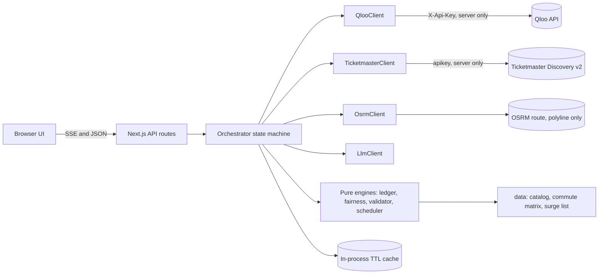
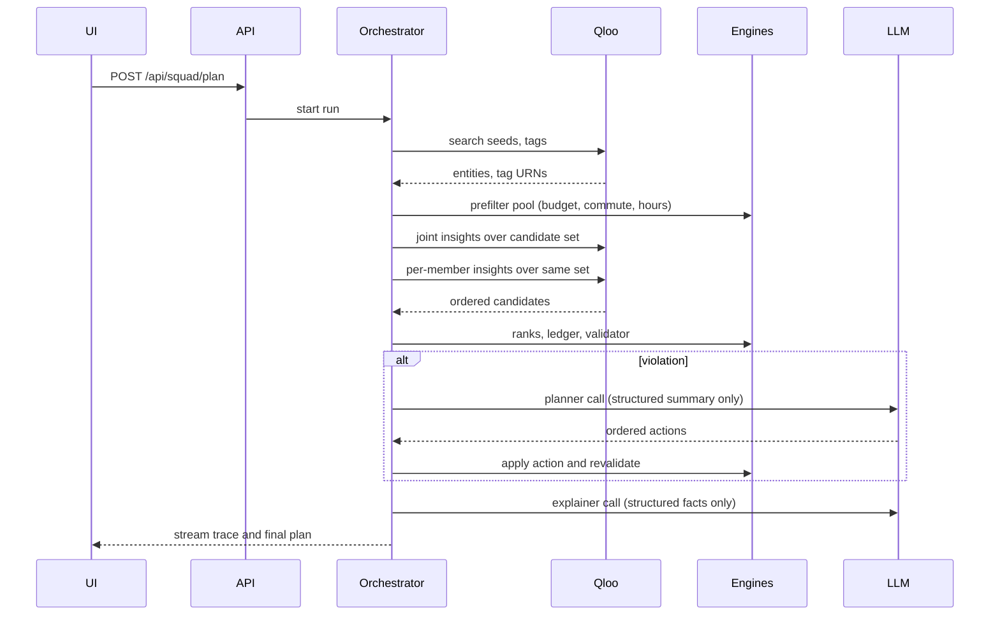

# ThirdPlace Squad: Product Requirements Document (PRD.md)

Culturally grounded third-place routines and multi-friend hangout consensus, powered by Qloo, for the Qloo Agentic Hackathon ("Agents, but with taste.", 2026 edition).

## 1. Document Status and Executive Summary

### 1.1 Status metadata

| Field | Value | Epistemic status |
| :- | :- | :- |
| Product name | ThirdPlace Squad (merged concept of "ThirdPlace Match" solo routine planning and "SquadSplit" multi-friend consensus and budget split) | [Planning Assumption] |
| Event | Qloo Agentic Hackathon, https://https://www.google.com/search?q=qloo.devpost.com/ (challenge page accessed 2026-10-21 and 2026-10-23) | [Verified Fact] |
| Document as-of time | 2026-10-27, 11:19 IST (Asia/Kolkata, UTC+5:30) | [Verified Fact] |
| Submission deadline | 2026-10-30, 11:45 PM EDT = 2026-10-30, 8:45 PM PDT = 2026-10-31, 9:15 AM IST | [Verified Fact] (Devpost overview, rules and schedule pages; conversion computed, see section 2.1) |
| Internal submission target | 2026-10-30, 6:00 PM IST, which leaves 15 h 15 min of buffer before the deadline | [Planning Assumption] |
| Time left at document time | 93.9 hours to the deadline, 78.7 hours to the internal target (48-hour streamlined build schedule active, see section 19) | [Verified Fact] (computed arithmetic) |
| Selected opportunity | Squad Consensus Mode plus Solo Routine Mode over one shared engine, launch metro Chicago, IL | [Planning Assumption] (see 1.2 for how it was selected) |
| Intended user | Young adults aged 18 to 30 (students, interns, new graduates, 20-something friend groups) in a city where they lack established social routines | [Planning Assumption] |
| Core outcome | A plan that every member of a 2 to 5 person friend group can afford, reach, and enjoy (with default P0 Blind Cap Mode masking individual budget caps), produced before anyone leaves home, plus a 3-stop weekly routine for a solo newcomer benchmarked against BLS under-25 spending | [Proposed Target] |
| Qloo contribution | Cross-domain taste resolution (media seeds to tags and entities), candidate discovery and per-member place affinity ranking over a sourced venue catalog, pairwise audience comparison (`GET /v2/insights/compare`) for a Shared Cultural DNA card, and optional neighborhood affinity heatmap | [Planning Assumption] (capabilities in section 11 are [Verified Fact] from kit, harness code, and live 2026 Devpost submission reports; live behavior is an [Unverified Dependency] until Gate G0) |
| Sponsor coverage | 1 of 1 verified sponsors integrated (Qloo). No other sponsor is verified. | [Verified Fact] |
| Most important unresolved dependency | Event-issued Qloo credential, its quota, and whether Qloo resolves enough small Chicago venues (see VB-01 and VB-02 in section 21) | [Unverified Dependency] |
| License of this PRD's planned repository | MIT | [Planning Assumption] |

### 1.2 How the opportunity was selected (transparency)

The requester supplied a master brief that designates ThirdPlace Squad as the concept and names two alternative finalists (FirstLease Vibe, FestSquad Solver). This PRD therefore treats the selection as requester-directed and then stress-tests it:

1. The hackathon facts, kit, and Qloo harness were verified first from primary sources (section 2 and the register in section 22).
2. Ten opportunities were re-scored against hard gates and two scoring matrices (section 3). ThirdPlace Squad survived the gates and ranked first under every weighting tried, but the margin over FirstLease Vibe is small under official-criteria scoring and is a judgment, not a measurement.
3. Evidence depth is uneven. Deep evidence was collected only for the selected concept. A parallel research sweep of other candidate problem areas was started and aborted by a platform usage limit, so scores for non-selected opportunities rest on thinner evidence and are labeled with low confidence.

### 1.3 Known limitations of this research pass

* The Qloo documentation site (https://www.google.com/search?q=docs.qloo.com) could not be fetched by the research tooling (robots restriction on the fetcher and an egress block). Qloo API facts in this PRD are therefore taken from the official kit repository, the published `@qloo/qloo-harness` 0.1.26 package (tool schemas and dry-run request shapes inspected locally), and Qloo marketing pages. Anything only the Qloo docs could confirm is marked [Unverified Dependency].
* No Qloo API key was available, so no live Qloo request was made. There are no measured Qloo results in this document.
* Individual Devpost discussion threads could not be opened. Only the thread titles on the forum index were read.
* The Devpost 2025 gallery claim in the brief (heavy presence of trip planners and date generators) was not independently re-verified and is carried as requester-supplied.

### 1.4 Executive summary

Young adults who move to a new city or simply try to organize a hangout hit two linked failures. Alone, they lack affordable places where people with their cultural taste gather ("third places"). In a group, plans stall because tastes diverge, budgets differ, and one person always travels farthest. Existing tools solve fragments: Yelp and Google Maps filter by category and rating, Google Maps can poll a shortlist, Partiful sends invitations, Splitwise settles money after it is spent, and midpoint apps balance geography only.

ThirdPlace Squad is an agent that:

1. Resolves each person's favorite media (artist, movie, TV show, book, video game, podcast) into Qloo entities and tags.
2. Asks Qloo how strongly each person's taste profile matches each venue in a small, hand-sourced Chicago venue catalog.
3. Verifies hard constraints with deterministic code: per-person budget caps, round-trip commute for every member, opening windows, and optional live-event conflicts.
4. Replans when a constraint or fairness floor is violated (budget breach, commute breach, taste alienation of any single member), within bounded retries.
5. Calls `GET /v2/insights/compare` (`compare_audiences`) across member seed profiles to generate a "Why Your Squad Clicks" Shared Cultural DNA card showing shared taste tags versus each friend's distinctive tags.
6. Returns a plan with a per-friend taste and commute scorecard (with default P0 Blind Cap Mode masking individual budget caps so the lowest-budget friend is protected without social stigma), a 13-row integer-cent split ledger with BLS under-25 weekly savings benchmarking, a provenance drawer showing the exact Qloo requests, and an exportable group-chat invite.

Qloo is essential because the core decision, "which physical place fits a group whose tastes are expressed as books, games, shows, and artists", cannot be made from category filters. Removing Qloo collapses the engine to distance and generic popularity, which the evaluation in section 16 compares against on identical inventory.

The central risk is not the idea but access and coverage: the Qloo credential and quota, and whether Qloo indexes enough independent Chicago venues. Gate G0 (Phase 0) tests both within the first build day and defines stop and narrow conditions.

### 1.5 Epistemic taxonomy used throughout

| Label | Meaning |
| :- | :- |
| [Verified Fact] | Confirmed from an official rule page, vendor specification, repository or package file, or a cited primary source, with access date given in section 22. |
| [Research-Supported Inference] | A conclusion drawn from two or more verified sources. |
| [Planning Assumption] | An operating parameter adopted to bound the build (hours, call budgets, default thresholds). |
| [Proposed Target] | A design or performance goal to be evaluated. It is never presented as achieved. |
| [Unverified Dependency] | An external condition (quota, entity density, third-party behavior, rule interpretation) that must be validated at Gate G0 before full commitment. Statements from the requester's brief that this research could not re-verify are carried under this label. |
| [Measured Result] | Reserved for numbers actually computed or benchmarked. Where this label appears in this version, it refers only to arithmetic performed during document preparation (dates, hours, worked ledger examples). No product benchmark exists yet. |

## 2. Hackathon Requirements and Traceability

### 2.1 Verified dates, with timezone math

US daylight saving time ends on Sunday 2026-11-01, so the submission deadline is still in EDT (UTC-4) and the judging period is in EST/PST.

| Milestone | Eastern time (Devpost) | Pacific time | IST (Asia/Kolkata) | Status |
| :- | :- | :- | :- | :- |
| Submission opens | Sep 30, 2026, 9:30 AM EDT (schedule page) or 9:00 AM ET (rules page) | 6:30 AM or 6:00 AM PDT | 7:00 PM or 6:30 PM IST, Sep 30 | [Verified Fact] (the two official pages differ by 30 minutes, which does not affect this build) |
| Submission deadline | Oct 30, 2026, 11:45 PM EDT | Oct 30, 8:45 PM PDT | Oct 31, 2026, 9:15 AM IST | [Verified Fact] |
| Judging begins | Nov 2, 2026, 12:00 PM EST | Nov 2, 9:00 AM PST | Nov 2, 10:30 PM IST | [Verified Fact] |
| Judging ends | Nov 16, 2026, 11:45 PM EST | Nov 16, 8:45 PM PST | Nov 17, 10:15 AM IST | [Verified Fact] |
| Winners announced | Nov 23, 2026, 3:00 PM EST | Nov 23, 12:00 PM PST | Nov 24, 1:30 AM IST | [Verified Fact] |
| Internal submission target | Oct 30, 2026, 8:30 AM EDT | Oct 30, 5:30 AM PDT | Oct 30, 6:00 PM IST | [Planning Assumption] |
| Hosting kept live through | Nov 24, 2026 (day after winners announcement) | n/a | Nov 24, 2026 | [Planning Assumption] (the rules require free, unrestricted access until the judging period ends on Nov 16; the extra week is a margin) |

### 2.2 Usable build window

| Quantity | Value | Status |
| :- | :- | :- |
| Hours from document time (Oct 27, 11:19 IST) to deadline | 93.9 h | [Verified Fact] (arithmetic) |
| Hours to internal target (Oct 30, 18:00 IST) | 78.7 h | [Verified Fact] (arithmetic) |
| Assumed working capacity | Tuesday Oct 27 to Thursday Oct 29: 11 h per day (33 h); Friday Oct 30 until 18:00 IST: 8 h; plus 7 h already completed on Phase 0 probe and Phase 3 ledger engine; total 48 h active build | [Planning Assumption] (solo generalist developer) |
| Net engineering budget | 48 h streamlined baseline (60 h full architecture reference retained in section 19.1) | [Planning Assumption] |
| Completed artifacts in repository | Deterministic 13-row integer-cent ledger and Pareto fairness engine (`lib/engine/thirdPlaceLedger.mjs`), 4/4 automated unit and property test suites (`tests/thirdPlaceLedger.test.mjs`), and Phase 0 Chicago seed/venue probe (`scripts/phase0-thirdplace-probe.mjs`) | [Measured Result] |
| Post-target safety buffer | 15 h 15 min (Oct 30, 18:00 to Oct 31, 09:15 IST), reserved for deployment fixes only, not feature work | [Planning Assumption] |

Because 78.7 hours remain to the internal submission target, the 48-hour streamlined build plan (18 validated Chicago venues, 2 to 3 squad members default with up to 4 supported, HTTP Qloo client, precomputed OSRM matrix, and the already-verified deterministic ledger engine) is the active execution baseline in section 19.2.

### 2.3 Cross-edition reconciliation (2025 versus 2026)

| Item | 2025 "Qloo LLM Hackathon" (https://www.google.com/search?q=qloo-hackathon.devpost.com) | 2026 "Qloo Agentic Hackathon" (https://www.google.com/search?q=qloo.devpost.com) | Treatment in this PRD |
| :- | :- | :- | :- |
| Event URL | Separate Devpost site | https://https://www.google.com/search?q=qloo.devpost.com/ | Only 2026 pages are used for rules, dates, prizes, criteria. |
| Rules, prizes, sponsors | Not imported | Taken only from the 2026 pages | No 2025 sponsor, prize, or entitlement is assumed. |
| Project gallery | Used only as a landscape signal. The brief states it was dominated by vacation planners and 2-person date generators. | The event gallery index (`qloo.devpost.com/project-gallery`) hides entries until the deadline, but individual 2026 submission pages on `devpost.com/software/*` are publicly indexed (including TasteFit, Crowd Pleaser, SquadVibe, TasteBridge, and Undercard; see section 3.4). | [Verified Fact] for the indexed 2026 Devpost software pages (S-29 to S-34). |
| API access | Not assumed | Event-issued credential via a Google Form linked from the Devpost overview and resources pages | See HR-10. |

### 2.4 Binding requirements and traceability (HR-01 to HR-10)

| ID | Requirement | Source and status | Planned implementation | Submission evidence |
| :- | :- | :- | :- | :- |
| HR-01 | The project must integrate the Qloo API. | Rules page [Verified Fact] | Server-side Qloo adapter calling `/search`, `/v2/tags`, `/v2/audiences`, `/v2/insights`, and `/v2/insights/compare` (section 11). | Provenance drawer showing real request paths and correlation IDs; Shared Cultural DNA card; repository adapter code; README. |
| HR-02 | The project must qualify through one permitted agentic route: function as an agentic tool, be built with an agent framework, or wire Qloo into an existing agent. | Rules page [Verified Fact] | Route (a): the product is an agentic tool with a bounded plan, tool-call, validate, replan loop (section 10). Qloo tool contracts mirror the harness workflows so the same tools can be exposed over `qloo mcp` (route c) as an optional adapter. | State machine trace in the UI; section 10 contracts; repository tests of the loop. |
| HR-03 | Cultural intelligence must be material. The overview states: "If your submission would work the same without Qloo, you're building the wrong thing." | Devpost overview [Verified Fact] (as extracted) | Qloo ranks venues per person; baseline arms (distance and popularity, optional LLM-only) on identical inventory (section 16). | Compare mode and evaluation report in the repository. |
| HR-04 | A working, externally hosted app with working access for judges. The rules require the project to be free and unrestricted for testing until the judging period ends. No judge-supplied credentials. | Overview and rules pages [Verified Fact] | Public HTTPS URL, no login, Qloo key held server-side only, 3 one-click presets. | Deployed URL in submission; uptime check log. |
| HR-05 | A public repository (GitHub, GitLab, or Bitbucket) with all source code, assets, and setup instructions. | Rules page [Verified Fact] | Public GitHub repo with lockfile, `.env.example`, seed catalog, setup steps. | Repository URL. |
| HR-06 | An open-source license file visible in the repository's About section. | Overview and rules [Verified Fact] | MIT `LICENSE`, About panel set to show it. | Screenshot of the About panel. |
| HR-07 | A text description of features and what makes the project Qloo-powered. | Overview and rules [Verified Fact] | Devpost description following section 20.4. | Submitted description. |
| HR-08 | The project must be newly created, or significantly updated during the submission period, with updates explained. The rule text was garbled in the fetched copy. | Rules page [Verified Fact] for the existence of the rule; exact wording is an [Unverified Dependency] | Repository created for this build with a first commit after the period opened; any reused code is listed in the README. | Commit history; README "what is new" section. |
| HR-09 | Third-party SDKs, APIs, and data must be used according to their terms. | Rules page [Verified Fact] | Ticketmaster and OSRM terms honored as described in sections 11, 13, and 17. | Terms notes in the README. |
| HR-10 | Credential handling and data safety. Each participant uses an event-issued, individually attributable credential; keys never live in a repository, browser bundle, or public config. Aggregate affinities must not be used to infer identity or sensitive traits, and personal data must not be sent to Qloo merely to make a demo work. | Kit docs `API_ACCESS.md` and `SAFE_USE.md` [Verified Fact] | Key in a server environment variable only. Member labels, names, and any free text never leave the server toward Qloo; only media seed names and Qloo tag URNs do. No health, finance, or eligibility inference. | Redacted request log in the provenance drawer; privacy section 17. |

Additional verified points: demo videos are not required (Devpost overview), judges may judge from the written description and images alone (rules), submissions are locked after the deadline except for limited permitted modifications (rules), and an entrant may submit multiple projects only if they are substantially different (rules).

### 2.5 Stage 2 judging matrix (four criteria, 25% each)

Stage 1 is a pass or fail check for viability, theme fit, and proper use of the required APIs. Stage 2 uses four equally weighted criteria [Verified Fact].

| Criterion (weight) | What judges are told to look for [Verified Fact] | How ThirdPlace Squad demonstrates it | Judge walkthrough step (section 20) |
| :- | :- | :- | :- |
| Technological Implementation (25%) | How thoroughly and skillfully Qloo is used, non-trivial working code, effective agentic execution | Multi-endpoint Qloo use (search, tags, audiences, insights, optional heatmap), per-member scoring pattern, deterministic integer-cent engine, bounded replan loop, tests, provenance | Steps 2, 3, 4 |
| Design (25%) | A complete, coherent product experience, not a proof of concept | One workspace with two modes, nine defined UI states, scorecard, ledger, export, mobile layout | Steps 1, 3, 5 |
| Potential Impact (25%) | A credible, specific case for a real problem and a real audience; commercial viability beyond the hackathon | Evidence-backed problem statement (section 4), adoption loop and wedge (section 18), honest metrics (section 6) | Step 5, description |
| Quality of the Idea (25%) | Creative, non-obvious use of Qloo and improvement on existing solutions | Cross-domain media to physical venue bridge, Pareto per-friend fairness, pre-spend budget enforcement | Steps 3, 4 |

### 2.6 Prizes and offers

| Item | Detail | Status |
| :- | :- | :- |
| Cash prizes | 1st $15,000, 2nd $6,000, 3rd $4,000 (total $25,000) | [Verified Fact] |
| Minimum score for cash prizes | The brief states a 40% average Stage 2 score is required. This was not seen in the rules extract and could not be re-fetched. | [Unverified Dependency] |
| Calacanis bonus challenge | A personal $25,000 investment into his favorite entry. It is separate from the cash prizes and its terms are not specified on the pages read. Investment diligence conditions should be assumed, not verified. | [Verified Fact] for the offer; conditions are an [Unverified Dependency] |
| One prize per project; taxes and fees on winners; payment after forms | Rules page | [Verified Fact] |

### 2.7 Material rule and access uncertainties

| # | Uncertainty | Why it matters | Resolution path |
| :- | :- | :- | :- |
| U-1 | Whether direct server-side REST calls to Qloo satisfy the event's stated "supported surfaces" (`qloo explore`, `qloo exec`, `qloo api`, `qloo mcp`). The kit's `API_ACCESS.md` names only those four. | A Stage 1 reviewer could read the kit as exclusive. | Section 11.2 defines a client interface with an HTTP implementation and a harness implementation. Ask organizers in the kit Q&A discussions at G0 and keep the harness path buildable. |
| U-2 | The API host for the event credential. The brief names `https://hackathon.api.qloo.com`. The harness 0.1.26 treats only `https://api.qloo.com` as official and rejects other hosts unless explicitly trusted. A forum thread titled "Hackathon key returns 401 API keys mismatch" exists. | A wrong host produces authentication failure. | The base URL is configuration. VB-01 probes with `qloo doctor --network` and one `/search` call. |
| U-3 | Quota, rate limit, and credential expiry. The kit says organizers must publish these before access is granted. None were found on the Devpost pages read. | Judge traffic plus replans can exhaust an unknown quota. | VB-05, per-run call budget (40), aggressive caching, cached-preset mode that is clearly labeled. |
| U-4 | Credential delivery delays. At least four of seven forum thread titles concern missing or failing keys. | No key means no project. | Request access immediately; escalate via the kit support channel; stop condition in VB-01. |
| U-5 | The 40% prize threshold and exact new-work wording (see HR-08, 2.6). | Compliance wording. | Re-read the live rules page at G0 and before submission. |
| U-6 | Whether the rules require availability beyond Nov 16. | The plan hosts through Nov 24 regardless. | None needed. |

## 3. Research Findings, Opportunity Discovery, and Finalist Selection

### 3.1 Method and evidence limits

* [Verified Fact] Hackathon rules, kit documents, harness package, and third-party service terms were read from primary sources (section 22).
* [Planning Assumption] Ten candidate opportunities for young adults and small prosumers were defined, then screened with seven hard gates and two scoring matrices. The three finalists are the requester's: ThirdPlace Squad (merged #8 and #4), FirstLease Vibe (#1), and FestSquad Solver (#2).
* [Verified Fact] Problem-evidence sources for the selected concept were retrieved with access dates in section 22. Evidence for the other opportunities was not collected in depth because the parallel research sweep was interrupted. Their evidence confidence is marked Low and their scores are author judgments.
* No novelty claim in this PRD means "unique". The search scope for novelty is stated in 3.4 and cannot establish absolute uniqueness.

### 3.2 Opportunity landscape (ten opportunities)

The first table describes the problem side. The second describes the solution side.

| ID | Opportunity | Specific user | Trigger and hard decision | Current workaround | Problem-evidence confidence |
| :- | :- | :- | :- | :- | :- |
| 1 | FirstLease Vibe | 22 to 28 year old relocating for a first job | Choosing a neighborhood to rent in, sight unseen | Neighborhood guides, social posts, friends of friends | Low (not researched this session) |
| 2 | FestSquad Solver | Friend group at a multi-day music festival | Resolving set-time conflicts across 3 to 6 people | Group chat, spreadsheets, festival apps | Low |
| 3 | CampusCrate | Student club officers | Choosing events or speakers for a mixed-taste membership on a fixed budget | Polls, past-event habit | Low |
| 4 | SquadSplit Weekend | 2 to 5 friends planning a hangout | Choosing a venue everyone can afford, reach, and enjoy | Group chat, Google Maps shortlist voting, Splitwise afterward | Medium (see 3.3) |
| 5 | AuthorComps | Self-published authors | Finding comp titles and cross-media audiences for marketing | Manual search, paid keyword tools | Low |
| 6 | PodcastSponsor | Small podcast creators | Finding brands that fit their audience and pitching | Marketplaces, cold email | Low |
| 7 | GiftSignal | Long-distance friends and partners | Picking a gift matching taste across domains | Wish lists, guessing | Low |
| 8 | ThirdPlace Match | New graduates and interns in a new city | Choosing recurring affordable places where like-minded people go | Delivery apps, random bars, staying home | Medium (see 3.3) |
| 9 | DateNight Planner | Couples | Planning a two-person evening | Review apps, LLM chat | Low (crowded category per the requester's 2025 gallery claim, [Unverified Dependency]) |
| 10 | LinguaTaste | Language learners | Choosing authentic media in the target language that matches their interests | Learner lists, streaming recommendations | Low |

| ID | Why Qloo changes the decision | Agentic value | Data and API access | Adoption path | Main failure reason | Gate outcome |
| :- | :- | :- | :- | :- | :- | :- |
| 1 | Neighborhood-level affinity (heatmap) | Medium | No free rental-listing data, Qloo must not be used for housing eligibility or demographic steering | Consumer, B2B relocation | Missing listings data, fair-housing exposure | Defer (fails HG-1, HG-7) |
| 2 | Artist affinity per person | High | Set-time schedules not available in a free documented API for the judging window | Seasonal | No demonstrable data in November, short season | Defer (fails HG-1, HG-5) |
| 3 | Cross-domain taste of members | Medium | Member tastes are personal data, event catalog missing | Campus orgs | Data and privacy burden | Defer (HG-1) |
| 4 | Per-member place affinity over shared candidates | High | Sourced venue catalog plus Qloo plus OSRM | Viral through group chats | Qloo coverage of small venues | Pass |
| 5 | Cross-domain audience overlap | Medium | Works with Qloo alone | Author tools market | Low differentiation from existing tools, impact narrow | Pass but ranked lower |
| 6 | Brand and podcast affinity | Medium | Works with Qloo alone | Creator tools | Crowded marketing use case, little verifiable outcome | Pass but ranked lower |
| 7 | Cross-domain taste | Low | Needs product catalog and purchase rails | E-commerce | Weak agentic loop, low consequence | Defer (HG-4) |
| 8 | Seeds to venue ranking, neighborhood heatmap | High | Same as 4 | Campus and new-resident programs | Same as 4, plus routine adherence unmeasurable now | Pass |
| 9 | Place affinity for two people | Medium | Qloo plus maps | Consumer | Crowded, thin novelty | Pass but ranked lower |
| 10 | Cross-domain taste into foreign-language titles | Medium | Qloo cannot supply difficulty level, no free level data | Education | Fails the separation of taste from suitability | Defer (HG-1) |

Items 4 and 8 share one engine, one inventory, and one scoring and ledger module, so they were merged into one product with two modes. The merge adds one input form and one scheduler, not a second backend.

### 3.3 Evidence for the selected problem

| Claim | Source and date | Status |
| :- | :- | :- |
| About half of U.S. adults report loneliness, and people aged 15 to 24 report about 70% less time with friends in person than nearly two decades earlier. | Surgeon General advisory as reported by STAT/AP, 2023-05-02 | [Verified Fact] (secondary report of the advisory; the HHS primary PDF was not opened) |
| 66% of degree holders and 46% of adults without a degree report having a "third place". | New America, "The College Connection", survey published December 2021, n = 5,058 adults | [Verified Fact] (not broken out for young adults) |
| Consumer units whose reference person is under 25 spent $3,025 on food away from home in 2024, $2,804 in 2023, $2,551 in 2022. | BLS Consumer Expenditure Survey via FRED series CXUFOODAWAYLB0402M, updated 2025-12-19 | [Verified Fact] (a consumer unit is a household, not a person) |
| That is about $58 per week for food away from home per under-25 consumer unit. | Computed from the 2024 value ($3,025 divided by 52) | [Research-Supported Inference] and [Measured Result] for the arithmetic |
| The brief's figure that young adults spend $80 to $150 or more per weekend on default socializing has no source in this research. | Requester brief | [Unverified Dependency]. It is not used as a fact anywhere in this PRD. |
| Partiful averaged about 500,000 monthly active users in Q1 2025 (Sensor Tower estimate), mostly ages 20 to 30, and the article describes invitations, RSVPs, and group messaging without venue discovery or cost splitting. | CNBC article republished by NBC New York, 2025-04-19 | [Verified Fact] |
| Group "chat paralysis" frequency and cost have no direct statistic in this research. | None | [Unverified Dependency]. The problem is supported indirectly by the existence of group planning features (below), not by a measured rate. |
| CTA fares in 2026: bus $2.50, rail $2.75, day pass $6, 7-day pass $25, 30-day pass $85 (effective "in 2026", exact date not stated). | CBS Chicago, 2025-10-13 | [Verified Fact] (confirm on the CTA site before build) |
| Chicago combined sales tax rate is 10.25% (state 6.25%, Cook County 2.75%, city 1.25%), applied to prepared food. | TaxCloud guide dated 2026-10-07 | [Verified Fact] (secondary source, confirm with the Chicago Department of Finance in Phase 1) |

### 3.4 Competitor and alternative findings for the selected concept

Search scope: web searches on 2026-10-21 and 2026-10-23 for group planning, midpoint, strangers-dinner, invitation, and expense-splitting products, plus Devpost gallery checks. This does not establish uniqueness.

| Alternative | What it does well | Remaining gap | Source and status |
| :- | :- | :- | :- |
| Google Maps group planning | Shortlist places, share a list, friends vote, veto, and add places | No taste model across media, no per-person budget or fairness checks | TechCrunch, 2018-09-26 [Verified Fact]. Current feature set not re-checked [Unverified Dependency]. |
| Yelp and general map search | Category, rating, distance | Cannot map favorite books, games, or shows to places | Requester brief [Planning Assumption] |
| Partiful | Invitations, RSVPs, group messaging, large Gen Z user base | No venue discovery in the article, no split engine | NBC/CNBC, 2025-04-19 [Verified Fact] |
| Splitwise | Records and settles shared expenses | Acts after money is spent. Free-tier limits on daily expense entries were reported in late 2023, Pro priced at $5 per month or $40 per year in the U.S. | ITVoice, 2023-12-30 [Verified Fact] (secondary, may have changed) |
| FairMeet | Midpoint city for spread-out groups, free, launched 2026 | Geography only, travel time and cost data listed as future work by its maker | Product Hunt page [Verified Fact] |
| Timeleft | Pairs strangers for weekly dinners, about $16 per dinner plus the diner's own bill of roughly $20 to $40, 275+ cities, matching by questionnaire | Matching is not described as cultural taste based, no budget enforcement | Philadelphia Inquirer, 2024-10-22 [Verified Fact] |
| Generic LLM chat | Flexible suggestions | Cannot give locality-specific, quantified taste affinity, can invent venues and prices, cannot guarantee arithmetic | [Research-Supported Inference] and tested in section 16 |
| [TasteFit](https://devpost.com/software/tastefit-ghck8i) (2026 Qloo Hackathon submission) | Plans a night out in Chicago for 3 friends using separate per-person Qloo `/v2/insights` calls, a fairness swap pass, and plain-language replanning (`"cheaper"`, `"closer"`) | No Solo recurring weekly third-place routine mode, no 13-row integer-cent tax/tip/CTA/shared-item split ledger, no P0 Blind Cap Mode (`•••`) to protect the lowest-budget friend from stigma, and no `/v2/insights/compare` Shared Cultural DNA card | Devpost software page published 2026-10-21 [Verified Fact] (S-29) |
| [Crowd Pleaser](https://devpost.com/software/crowd-pleaser) (2026 Qloo Hackathon submission) | Takes 2 to 5 friends, resolves favorite artists, movies, and brands via Qloo, and sorts shared candidate places by minimum individual percentile score | Single-stop recommender only; no deterministic budget or commute constraints, no 2-stop micro-combo replanning, and no Solo weekly routine mode | Devpost software page published 2026-10-13 [Verified Fact] (S-30) |
| [MeetSpot](https://github.com/calderbuild/MeetSpot) (2026 Qloo Hackathon submission) | Scores nearby venues once per person in Qloo, ranks by maximin percentile, and checks max commute time per participant | No pre-spend itemized cost ledger (tax, tip, transit fare, shared items), no Blind Cap Mode, and no Solo recurring routine mode | Public GitHub repository updated Oct 2026 [Verified Fact] (S-31) |
| [SquadVibe](https://devpost.com/software/squadvibe-ai-group-plans-with-qloo) (2026 Qloo Hackathon submission) | Builds a 3-stop group itinerary with per-member Qloo coverage scoring and squad voting | Post-recommendation voting rather than pre-spend integer-cent budget enforcement and bounded constraint replanning | Devpost software page published 2026-10-10 [Verified Fact] (S-32) |

Differentiation against both commercial tools and 2026 Qloo Hackathon group planners (`TasteFit`, `Crowd Pleaser`, `MeetSpot`, `SquadVibe`) rests on four concrete wedges:

1. **Dual-Mode Architecture (Solo Weekly Third-Place Routine + Squad Consensus)**: None of the group-night-out submissions solve the weekday loneliness problem of building a repeatable 3-stop weekly third-place routine under a weekly budget cap (`LI-12` and `LI-13`).
2. **Pre-Spend 13-Row Integer-Cent All-In Split Ledger (`LI-01` to `LI-13`)**: Replaces coarse `$-$$$$` tiers with exact Chicago 10.25% sales tax, venue-type gratuity basis points, 2026 CTA rail/bus round-trip fares, deterministic shared-item remainder cent allocation, and a live weekly savings benchmark against the BLS under-25 food-away-from-home average (`$58.17/week`).
3. **P0 Blind Cap Mode (`blindCapMode: true` by default)**: Enforces the lowest member's budget cap mathematically while masking individual `LI-10` caps as `hidden (binding floor applied)` in the group scorecard and exported invite so no friend has to publicly announce being the broke bottleneck.
4. **Weighted 2-Stop Micro-Combo Replanning + `/v2/insights/compare` Cultural DNA Bridging**: Pairs a `$0` cultural anchor (bookstore, record shop, park, gallery) with a low-cost counter-service cafe when single stops fail taste or budget floors, and uses `GET /v2/insights/compare` to surface shared cultural tags versus distinctive member tags.

### 3.5 Hard pass or fail gates (finalists)

| Gate | ThirdPlace Squad | FirstLease Vibe | FestSquad Solver |
| :- | :- | :- | :- |
| HG-1 Essential data and API access exists | Pass, conditional on Qloo key and entity coverage (VB-01, VB-02). Catalog is hand-sourced. | Fail: no free documented listings source | Fail: no documented schedule data for the judging window |
| HG-2 No unconfirmed partnership or long approval | Pass (Ticketmaster key is self-serve, OSRM public, no partner) | Fail if listings need partnership | Pass |
| HG-3 Qloo is not decorative | Pass | Pass | Pass |
| HG-4 Agent adds workflow value | Pass (replan, tool loop) | Pass | Pass |
| HG-5 Core experience demonstrable publicly | Pass (Chicago presets) | Conditional on data | Fail in November (festival off-season) |
| HG-6 Fits the build window | Conditional (60 h, aggressive) | Fail | Conditional |
| HG-7 No unresolved deployment blocker and compliant with kit safe use | Pass with a hosting choice (Render Starter) | Fail: housing steering and eligibility sensitivity under `SAFE_USE.md` | Pass |

Result: FirstLease Vibe and FestSquad Solver are deferred on gates. They are still scored below so the comparison is transparent.

### 3.6 Official-criteria scoring (anchors, scores, confidence)

Anchored scale: 1 = absent or contradicted by evidence, 2 = weak with major gaps, 3 = adequate with notable gaps, 4 = strong with minor gaps, 5 = exceptional and evidenced. Scores are author judgments [Planning Assumption].

| Official criterion | ThirdPlace Squad | FirstLease Vibe | FestSquad Solver | Reason for the leading score |
| :- | :- | :- | :- | :- |
| Technological Implementation | 4 | 3 | 3 | Multi-endpoint Qloo use with a deterministic engine and a bounded loop. Other two lack data. |
| Design | 4 | 4 | 4 | All are plannable as coherent flows. |
| Potential Impact | 3 | 3 | 2 | Real problem, but outcomes unmeasured. Housing is higher stakes but riskier. Festival is seasonal. |
| Quality of the Idea | 4 | 4 | 3 | Media-to-venue bridge with per-person fairness is non-obvious. |
| Total (out of 20) | 15 (75%) | 14 (70%) | 12 (60%) | |
| Evidence confidence | Medium to Low | Low | Low | Only the selected concept has gathered sources. |

### 3.7 Practical decision matrix (author's own weights, not official policy)

Weights sum to 100. Scores use the same 1 to 5 anchors.

| Dimension | Weight | ThirdPlace Squad | FirstLease Vibe | FestSquad Solver |
| :- | :- | :- | :- | :- |
| Strength of problem evidence | 12 | 3 | 4 | 2 |
| Importance of Qloo | 15 | 4 | 4 | 4 |
| Agentic workflow value | 10 | 4 | 3 | 4 |
| Differentiation | 8 | 3 | 4 | 2 |
| User experience and demo clarity | 10 | 4 | 4 | 3 |
| Build feasibility | 15 | 3 | 2 | 3 |
| Data availability | 12 | 3 | 2 | 2 |
| Adoption and business credibility | 6 | 3 | 3 | 2 |
| Meaningful sponsor coverage (all candidates use Qloo only, 1 of 1) | 2 | 3 | 3 | 3 |
| Operational risk (higher score means lower risk) | 10 | 3 | 2 | 3 |
| Weighted mean (out of 5) | 100 | 3.35 | 3.08 | 2.87 |

### 3.8 Sensitivity analysis

| Weight change | ThirdPlace Squad | FirstLease Vibe | FestSquad Solver | Leader |
| :- | :- | :- | :- | :- |
| Base | 3.35 | 3.08 | 2.87 | ThirdPlace Squad |
| All dimensions equal | 3.30 | 3.10 | 2.80 | ThirdPlace Squad |
| Qloo importance doubled | 3.44 | 3.20 | 3.02 | ThirdPlace Squad |
| Feasibility and data doubled | 3.28 | 2.85 | 2.80 | ThirdPlace Squad |
| Evidence doubled | 3.31 | 3.18 | 2.78 | ThirdPlace Squad |
| Operational risk doubled | 3.32 | 2.98 | 2.88 | ThirdPlace Squad |
| Feasibility and data ignored (weight 0) | 3.48 | 3.48 | 2.99 | Tie with FirstLease Vibe |
| Adoption tripled and evidence doubled | 3.28 | 3.16 | 2.70 | ThirdPlace Squad |

All figures are [Measured Result] for the arithmetic only. The lead depends on data availability and feasibility, which are access questions, not merit questions. Under the official four-criterion scoring, lowering ThirdPlace Squad's Potential Impact from 3 to 2 produces a tie at 14, and raising FirstLease Vibe's Technological Implementation and Potential Impact to 4 would put it ahead (16 versus 15). The choice is therefore defensible but not decisive on merit.

### 3.9 Selection rationale

* Why ThirdPlace Squad: it is the only finalist whose entire core experience can be built from sources that are accessible now (Qloo with an event credential, a hand-sourced catalog, OSRM, an optional free Ticketmaster key) and demonstrated publicly during the judging window.
* Why FirstLease Vibe loses: no documented listings source, and neighborhood matching for housing sits close to the kit's prohibition on inferring eligibility or sensitive traits for housing decisions, plus fair-housing steering sensitivity [Research-Supported Inference, not legal advice].
* Why FestSquad Solver loses: festival schedule data and a live demonstration are not available in the judging window, and impact is seasonal.
* Biggest unresolved assumption: Qloo indexes enough independent Chicago venues (board-game cafes, record and book shops, small cinemas) and its place ranking over a supplied set of venue IDs discriminates between different seed profiles.
* Quickest test: VB-02 and VB-03 in section 21, about two hours once a key exists.
* Evidence that would abandon or narrow the direction: fewer than 12 of the targeted venues resolve to Qloo place IDs (narrow to the best-covered 4 neighborhoods and larger venues), or rankings for strongly different seed sets are near identical (narrow the claim to "taste-aware tie-breaker", reduce the fairness claims, and rethink the baseline comparison), or no credential arrives by Sunday Oct 25 midday (stop; see R-01).

## 4. Final Problem Statement

This section states the problem only. The solution is in sections 7 to 15.

**Who.** Young adults aged 18 to 30 in a large city: students, interns, new graduates relocating for a first job, and 20-something friend groups of 2 to 5 people. [Planning Assumption]

**When and where.** Two recurring moments, in one city at a time:

1. A person who recently arrived in a city, or who has lost the built-in social structure of school, wants regular places to spend a few evenings and a weekend afternoon each week where people with similar cultural taste gather, without overspending.
2. A small friend group tries to pick a weeknight or weekend plan in a group chat.

**What they are trying to accomplish.** Solo: build a repeatable weekly social routine within a weekly budget and a travel limit. Group: choose one or two stops that every member can afford, reach, and enjoy, and agree on who pays what before leaving home.

**Why current approaches fail.**

* Search and map tools filter by category, rating, and distance. They do not translate "I love Dune, Baldur's Gate 3, and Alvvays" into a physical place. [Research-Supported Inference from the competitor review in 3.4]
* Group planning features such as Google Maps shortlist voting let people vote on a list but do not model each member's taste, budget, or travel burden. [Verified Fact for the feature; Research-Supported Inference for the gap]
* Midpoint tools balance geography only. [Verified Fact for FairMeet's described scope]
* Expense tools such as Splitwise record money after it is spent. [Verified Fact, secondary source]
* A generic language model can suggest plausible venues, but it has no quantified locality-specific taste signal, can invent prices and hours, and cannot guarantee arithmetic. [Research-Supported Inference, tested in section 16]

**What failure costs them.**

* Isolation and wasted evenings. National data show that roughly half of U.S. adults report loneliness and that time spent with friends fell sharply among people aged 15 to 24 (STAT/AP, 2023). Having a third place is less common among adults without a degree (46%) than among degree holders (66%) (New America, 2021). [Verified Fact] A causal link to this product's problem is not established.
* Money pressure. Consumer units under age 25 spent $3,025 on food away from home in 2024, about $58 per week as a household average. [Verified Fact and Measured Result for the division] A single mismatched plan can exceed the cheapest member's weekly discretionary budget. [Planning Assumption]
* Social friction: the member with the smallest budget or longest commute silently absorbs the cost or drops out. [Planning Assumption, to be validated by user feedback, not measured]

**What successful resolution means.**

1. Solo: a 3-stop weekly routine whose all-in cost (spend, tax, tip, round-trip commute) does not exceed the stated weekly cap, whose stops are in the user's time and travel limits, and whose weekly savings against the BLS under-25 food-away-from-home benchmark (`$58.17/week`, `5817` cents) are quantified in `LI-13`.
2. Group: a 1-stop or 2-stop plan where every member's all-in cost is at or below the lowest member cap, every member's round-trip travel is within the group limit, and every member's Qloo-based taste rank for the plan clears a fairness floor. If no such plan exists, the product says so and explains which constraint blocks it.
3. In both modes the user can see what evidence supported each recommendation, and the product never presents an affinity score as a probability or a guarantee that a person will enjoy a place.

## 5. Users, Buyer, and Jobs to Be Done

Personas are inferred from the problem research and the brief. They are not validated by interviews. No willingness to pay has been measured. [Planning Assumption]

| Role | Description | Needs | Constraints | Adoption friction |
| :- | :- | :- | :- | :- |
| Solo New-in-Town User (primary, Solo mode) | New graduate, intern, or transfer student, 20 to 25, in a neighborhood they do not yet know well | Low-cost recurring places that match their media taste | Weekly social budget, travel limit, limited free evenings | Will not enter long profiles, distrusts generic "top 10" lists |
| Squad Organizer (primary, Squad mode) | The person who ends up doing the planning in a group chat | A plan to paste into the chat quickly that nobody can object to on money or distance | Time, wants defensible fairness | Must get others to enter seeds and caps, so entry must be under 60 seconds per member |
| Broke Squad Member (secondary) | The member with the lowest cap or longest commute | A guarantee that the plan stays under their cap and travel limit without exposing their exact cap to the group | Does not want to state a low cap openly in front of friends | Protected in P0 by default **Blind Cap Mode** (`blindCapMode: true`), which masks individual `LI-10` caps in the UI and export while enforcing the lowest cap; P1 adds multi-device share-link entry |
| Local Venue Partner (future, not in the hackathon build) | An independent cafe, record store, or board-game bar | New visitors who match their culture | Owners have no time for integrations | Adoption path in section 18 only |
| Buyer and approver | For the hackathon, none: it is free to the user. For a post-hackathon B2B wedge: a campus student-life office, new-resident or relocation program, or a venue collective. | See section 18 | Budget cycles, data privacy | [Unverified Dependency], no demand evidence |

Jobs to be done

* Solo: "When I am new in town with limited money, help me build a weekly routine of places that feel like mine, so I meet my kind of people without overspending."
* Squad: "When my friends disagree about what to do and what to spend, help me find one plan that is fair on taste, cost, and travel, and give me something I can paste into the chat."
* Fairness: "When one of us is broke or far away, make sure the plan protects that person by default."

## 6. Goals, Non-Goals, and Success Metrics

### 6.1 Goals

1. Deliver one complete judge journey for both modes on a live Chicago deployment with genuine Qloo calls.
2. Make Qloo's contribution visible and testable (per-member scorecard, provenance drawer, compare mode).
3. Guarantee budget and commute compliance with deterministic code.
4. Report evaluation results honestly, with small-sample limits stated.

### 6.2 Non-goals

* Booking, ticket purchase, reservations, or payment processing. The product never moves money. It produces a ledger and an invite.
* Accounts, stored profiles, or personal data retention. [Planning Assumption]
* Coverage beyond one validated metro, live transit routing, or live opening-hours verification.
* Inferring health, finances, identity, demographics, or eligibility of any person from Qloo output, as required by the kit's safe-use document.
* Claims of causal social benefit, such as reduced loneliness, within the hackathon.
* Revenue from Ticketmaster data (its terms forbid deriving revenue from API use; see section 17).

### 6.3 Success metrics (M-01 to M-06)

All targets are [Proposed Target] and all baselines are "none measured" unless stated. No metric below has been measured yet.

| ID | Metric | Definition | Baseline | Measurement method | Proposed target | Type and status |
| :- | :- | :- | :- | :- | :- | :- |
| M-01 | Run completion on judge presets | Share of automated runs of each preset that end in `completed`, `partial` (explained), or `infeasible` (explained) without `failed`, within 90 seconds | None | Script runs each preset 20 times against the deployed app, log terminal states | At least 95% non-failed | Technical quality, hypothesis |
| M-02 | Hard constraint compliance | Share of returned `completed` plans satisfying max member total at or below min member cap and every member's one-way commute within limit | Not applicable (deterministic) | Property-based unit tests on the engine plus validator assertions on every response | 100% on tests; any violation is a defect | Technical quality, hypothesis until tests run |
| M-03 | Minimum member taste rank | Mean over scenarios of the minimum within-query percentile rank across members, Qloo arm versus distance and popularity baseline arm | Baseline arm computed in the same scenarios | Compare mode on 6 to 15 controlled scenarios, same catalog, caps, and commute matrix | Qloo arm higher in at least 4 of 6 scenarios. Read with the circularity caveat in section 16. | User outcome proxy, hypothesis |
| M-04 | Latency | Wall-clock time from submit to terminal state | None | Server timing log, 20 runs per preset, report p50 and p95 | p50 under 35 s, hard cap 90 s | Technical quality, hypothesis |
| M-05 | Blind plan preference | Share of rater judgments preferring the Qloo-arm plan over the baseline-arm plan for the same persona card, plans blind and order randomized | None | At least 5 human raters who are not the developer, 6 scenarios, report counts and scenario-level majority only | Exploratory only, no significance claim | User outcome proxy, hypothesis |
| M-06 | Cost per completed run | Provider requests and LLM tokens consumed per completed run, plus estimated dollars | None | Server counters per run, price table filled with verified prices at G0 | Under 40 provider requests and 2 LLM calls | Technical quality, hypothesis |

Demonstration readiness is covered by the checklist in section 22. A post-hackathon user-outcome metric (for example, share of users who attend a suggested place within two weeks) is a hypothesis for later and is not measurable in this build.

## 7. Product Scope, Release Bounds, and Priorities

### 7.1 Release bounds [Planning Assumption]

* One validated metro: Chicago, IL (timezone America/Chicago).
* Eight neighborhoods: Wicker Park, Logan Square, Pilsen, Hyde Park, Lakeview, West Loop, Lincoln Park, Chinatown.
* 18 to 24 hand-sourced third-place venues (target 24 candidates, keep those that resolve in Qloo and have sourced prices and hours).
* Solo mode and Squad mode with 2 to 4 members (the brief mentions up to 5 users in the problem statement, but per-member Qloo scoring queries are budgeted for 4).
* Commute modes: walk, bike, and drive or rideshare, computed with OSRM. Public transit time is not modeled (see 13.4 and the correction in section 21). CTA fares may be added as a cost line.

### 7.2 Priorities

| Priority | Capability | Why it is necessary |
| :- | :- | :- |
| P0 | Seed resolution with ambiguity handling and cold-start tag bridging (FR-01) | Without valid Qloo IDs there is no taste signal. |
| P0 | Multi-domain Qloo discovery, candidate discovery intersection, per-member fixed-pool scoring, and `/v2/insights/compare` Shared Cultural DNA card (FR-02) | This is the core Qloo contribution and cross-member explainability proof. |
| P0 | Constraint verification and bounded replanning with budget, commute, and taste-floor triggers (FR-03) | This is the agentic value and the product promise. |
| P0 | Interactive workspace, scorecard, and provenance drawer (FR-04) | Judges must see evidence and use the product without help. |
| P0 | 13-row integer-cent split ledger (with `LI-13` BLS weekly savings benchmark), default P0 Blind Cap Mode (`blindCapMode: true`), and group-chat invite export (FR-05) | Completes the user journey and protects the lowest-budget member without social friction. |
| P0 | Compare mode, Qloo arm versus distance and popularity arm (FR-06) | Proves Qloo's contribution (HR-03). |
| P0 | Solo weekly routine scheduler (3 slots) | Second mode of the product, reuses the engine. |
| P0 | Deployment, license, README, presets | Submission eligibility. |
| P1 | Qloo neighborhood heatmap overlay (separate contract) | Visual, but gated on Phase 0 validation. |
| P1 | Ticketmaster live-event anchor and large-venue surge warning | Real-world check, but optional and terms-limited. |
| P1 | LLM-only baseline arm in compare mode | Stronger counterfactual. |
| P1 | Calendar (.ics) export, private cap entry by shared link | Polish. |
| P1 | Brand or podcast conversation starter enrichment | One extra Qloo call. |
| P2 | Second metro, transit time from GTFS, venue partner portal, accounts, push notifications | Post-hackathon. |

### 7.3 Scope reduction order

See section 19.4. The journey stays complete under every reduction: seed entry, live Qloo ranking, constraint check, scorecard, ledger, invite.

## 8. User Journeys and Interface State Specification

### 8.1 Three judge presets (same validated Chicago corridor)

The presets are one click each and need no login. Their seeds are examples to be confirmed at Gate G0 against live Qloo resolution. The specific outcomes shown to judges are whatever the live system produces; the presets are designed to make the replan triggers likely, not guaranteed.

| Preset | Mode | Setup | Designed to exercise |
| :- | :- | :- | :- |
| A: "New in Logan Square" | Solo | Seeds: Dune (book), Baldur's Gate 3 (video game), Alvvays (artist). Vibe tags: cozy, indie. Home: Logan Square. Slots: Tuesday evening, Thursday evening, Saturday afternoon. Max one-way 25 minutes by walk or bike. Weekly cap $35. | Weekly burn-rate waterfall, 3 distinct venue types |
| B: "Three friends, three budgets" | Squad (3) | Member 1: Wicker Park, cap $35, seeds Dune and Baldur's Gate 3. Member 2: Logan Square, cap $25, seeds Alvvays and Past Lives. Member 3: West Loop, cap $18, seeds Kendrick Lamar and The Bear. | Budget cap breach and taste alienation replans, 2-stop combo |
| C: "Far apart" | Squad (3) | Hyde Park, Logan Square, and Pilsen origins with a 30 minute one-way limit and mixed caps. | Commute fairness breach and neighborhood shift |

### 8.2 Core journey (Squad mode, first visit to useful outcome)

1. Landing: two buttons ("Plan my week", "Plan with friends") and three presets. No login or key prompt.
2. Squad setup: enter 2 to 4 members. Each member has a label (kept in the browser only, never sent to the server, Qloo, or the model), origin neighborhood from the eight, commute mode, personal cap, hard filters (dietary, accessibility), and 2 to 3 seeds chosen from search-as-you-type results with entity type and short description shown.
3. Ambiguity check: if a seed has several plausible matches, the UI shows named candidates (name, type, short context) and asks the user to choose. It never asks the user to pick raw identifiers.
4. Run: the agent trace streams concise steps (see 8.4).
5. Result: the recommended plan (1 or 2 stops), a "Why Your Squad Clicks" Shared Cultural DNA Card (powered by `GET /v2/insights/compare`), a Per-Friend Taste and Commute Fairness Scorecard (with P0 Blind Cap Mode masking individual `LI-10` caps by default while displaying each member's green pass badge and slack against the binding group floor), the 13-row itemized ledger, map with the route and optional heatmap overlay, and a "Why this plan" panel with evidence.
6. Refinement: the user can lock a venue, raise a cap, change a mode, remove a member's seed, or ask "something cheaper" or "closer". Each refinement re-runs the agent with a new bounded budget.
7. Export: copy a group-chat invite and a split ledger. Optional .ics (P1).

Solo mode replaces steps 2 and 5: one person, a weekly cap, three time slots, and a weekly burn-rate waterfall.

### 8.3 The nine UI states

| State | Trigger | What the UI shows | Exit |
| :- | :- | :- | :- |
| 1 Empty | First load or reset | Presets and the two mode buttons, plain explanation of what Qloo contributes | User starts or selects a preset |
| 2 Loading | Run in progress | Streaming trace with elapsed time, current stage, and number of Qloo calls so far | Terminal state or cancel |
| 3 Ambiguous seed | `needs_input` from Qloo search | Candidate list per seed, with a "skip this seed" option | User choice, then resume |
| 4 Cold start | A seed has no usable entity | Message that the title is not indexed, offer to bridge with tags (for example genre or mood tags found through `/v2/tags`) and show which tags were chosen | User accepts tags or changes seed |
| 5 Partial | Some provider data missing (for example Ticketmaster or heatmap failed) | The plan with a visible "not checked" badge per missing check | None required |
| 6 Cached | Result served from the 24 hour cache or a preset snapshot | A "cached result, age X hours" badge. Cached results are never presented as live. | "Refresh live" button |
| 7 Infeasible | Replan budget exhausted with no plan meeting hard constraints | The binding constraint named, the closest violating plan marked as not recommended, and one-tap relaxations (raise cap, widen commute, drop a member's hard filter) | User relaxes or exits |
| 8 Cancelled | User cancels or timeout of 90 s | Partial trace kept, no plan shown as recommended | Restart |
| 9 Completed | Plan passes the validator | Plan, scorecard, ledger, map, evidence, export | Refine or export |

### 8.4 Agent transparency without private reasoning

The UI shows observable events only: tool called, inputs (seed names and tag URNs, never member labels), counts of results, rule checks passed or failed with the numbers, replan trigger name and chosen action, and the final validator verdict. It does not show model chain-of-thought. The "Why this plan" text is generated from structured facts only and is checked by a validator so that every number it cites exists in the result record (see section 10.5).

## 9. Functional Requirements (FR-01 to FR-06)

Each requirement lists purpose, priority, trigger and preconditions, inputs, expected behavior, outputs, failure behavior, acceptance criteria (AC), and dependencies. All acceptance criteria are [Proposed Target] until the tests exist.

### FR-01 Seed resolution with ambiguity handling and cold-start bridging

* Purpose and priority: turn user-entered media seeds into valid Qloo entities or tags. P0.
* Trigger and preconditions: user submits a Solo or Squad form. A server-side Qloo credential is configured.
* Inputs: per member, 2 to 3 seeds (text plus optional domain from artist, movie, tv_show, book, videogame, podcast) and up to 3 vibe or activity phrases. Cap of 3 seeds per member, 12 across a squad.
* Expected behavior:
  1. For each seed call `GET /search` with the query text and one entity type URN, `take` of 5.
  2. Auto-accept only when exactly one candidate matches the normalized input name in the chosen type. Otherwise return `needs_input` with up to 5 named candidates (name, type, short description).
  3. For vibe phrases call `GET /v2/tags` with a text query and present top tags for confirmation when more than one is plausible.
  4. Cold start: if no entity result exists, offer tag bridging (genre or mood tags found through `/v2/tags`) and mark the seed as `tag_bridged`.
* Outputs: `ResolvedSeed` records (see section 14) with Qloo entity ID or tag URN, resolution kind (exact, chosen, tag_bridged), and provenance.
* Failure behavior: retryable Qloo errors are retried within the budget in 10.6. Auth errors stop the run with a plain message and the `QLOO_AUTH` category. Empty results move to cold-start.
* Acceptance criteria:
  * AC-01.1 An exact unique match produces no prompt.
  * AC-01.2 An ambiguous seed produces UI state 3 with at least 2 named candidates.
  * AC-01.3 No code path builds an entity ID or tag URN from a name. IDs enter the system only through the adapter's parse of an API response (enforced with a branded type and a test).
  * AC-01.4 No member label or free text other than a seed or tag phrase appears in any outbound Qloo request (test with a request recorder).
  * AC-01.5 A seed with no entity result yields at least one tag option or a clear "cannot bridge" state.
* Dependencies: Qloo credential (VB-01), `/search` and `/v2/tags` behavior (VB-02).

### FR-02 Multi-domain Qloo discovery, fixed-pool per-member scoring, and audience comparison

* Purpose and priority: discover and rank venue candidates by each member's taste and by the pooled squad taste, and extract shared versus distinctive cultural tags across members. P0.
* Trigger and preconditions: seeds resolved. The venue catalog has Qloo place IDs resolved in advance (Phase 1).
* Inputs: resolved seeds, member constraints, catalog.
* Expected behavior:
  1. Deterministic prefilter creates the feasible pool $P$ of size $N_{\text{pool}}$: hours, hard filters, one-way commute limit, and a cost screen at the venue's low-cost tier against the lowest cap.
  2. Candidate discovery and pool intersection: query `GET /v2/insights?filter.type=urn:entity:place&filter.location.query=Chicago&take=50` with each member's resolved seed entities and tags, intersect returned place IDs with the feasible catalog pool $P$, and for any catalog venues in $P$ not returned in the top-50 discovery response, batch their Qloo entity IDs in chunks of at most 10 via `filter.results.entities` (respecting the harness 10-ID restriction cap when applicable).
  3. One joint `GET /v2/insights` call with `filter.type=urn:entity:place`, the pooled seeds (at most 10 signals; if more, each member contributes their first two seeds), pooled tag signals, and the candidate set restriction.
  4. One per-member call (at most 4) over the exact same candidate pool $P$ with that member's seeds only.
  5. Fixed-pool within-query percentile rank (`Fix F-01`): for a fixed candidate pool of size $N_{\text{pool}} \ge 2$ where $k$ venues ($1 \le k \le N_{\text{pool}}$) are returned in descending affinity order, each returned venue at 1-based position $\text{pos}(m, v) \in \{1, \dots, k\}$ (with ties taking the average position) receives rank $R(m, v) = 1 - \frac{\text{pos}(m, v) - 1}{N_{\text{pool}} - 1}$. Any venue in the fixed candidate pool omitted by Qloo for member $m$ is assigned the tied bottom position $\text{pos}_{\text{unscored}} = \frac{k + 1 + N_{\text{pool}}}{2}$ so the denominator is always locked to $N_{\text{pool}} - 1$ and never inflates ranks when fewer than $N_{\text{pool}}$ items come back.
  6. Pairwise audience taste comparison (`compare_audiences`): in Squad mode, call `GET /v2/insights/compare` (or the harness `compare_audiences` workflow) between member seed groups (`signal.interests.entities` for Member A versus Member B, plus Member A+B versus Member C for 3-person squads) to extract Qloo-verified shared cultural tags and distinctive member tags for the "Why Your Squad Clicks" Shared Cultural DNA Card.
  7. Optional separate heatmap contract (P1) and optional brand or podcast enrichment (P1).
* Outputs: for every candidate in $P$, $R(m, v)$ per member over the fixed denominator $N_{\text{pool}} - 1$, the display-only raw affinity from that single query, popularity if returned, shared and distinctive tag lists from `/v2/insights/compare`, and provenance.
* Failure behavior: if fewer than 5 candidates are scored for any member, the run continues as `partial` with a banner and tag-only fallback when possible. If fewer than 3 are scored, the run ends `infeasible` with the reason "not enough Qloo coverage for these seeds in this catalog". If `/v2/insights/compare` fails or times out, the Shared Cultural DNA Card falls back to the set intersection of resolved `/v2/tags` URNs across members and marks `compareStatus: "tag_intersection_fallback"`.
* Acceptance criteria:
  * AC-02.1 Raw affinity values are never averaged or compared across different Qloo queries. Scoring functions accept fixed-pool percentile ranks only (code review plus unit test).
  * AC-02.2 The joint and per-member queries evaluate the exact same fixed candidate pool $P$ of size $N_{\text{pool}}$, and unreturned venues receive the tied bottom position $\frac{k + 1 + N_{\text{pool}}}{2}$ (verified in `tests/thirdPlaceLedger.test.mjs`).
  * AC-02.3 A full Squad run of 4 members issues at most 40 provider requests in total, counting Qloo, Ticketmaster, and OSRM.
  * AC-02.4 An identical seed hash within 24 hours causes zero Qloo calls and shows the cached badge.
  * AC-02.5 A heatmap or `/v2/insights/compare` failure never removes or reorders venue results.
* Dependencies: VB-02 and VB-03.

### FR-03 Constraint verification, event check, and replanning

* Purpose and priority: guarantee hard constraints and fairness, and recover when they fail. P0.
* Trigger and preconditions: a candidate plan exists.
* Inputs: candidate plan (1 or 2 stops), member constraints, commute matrix, cost model, optional Ticketmaster events.
* Expected behavior:
  1. Deterministic validator computes the ledger (section 15), commute per member (outward and return legs), taste floor, hours, and filters.
  2. Ticketmaster check (P1) returns one of `checked_clear`, `conflict_found`, `truncated_pagination`, or `check_failed`. `checked_clear` means no matching listed events in the checked source for the window, never "no events exist".
  3. On any violation the agent selects a replan action from the allowlist (10.4). Maximum 3 replans.
* Replan triggers (at least 3 supported): BUDGET_CAP_BREACH, COMMUTE_FAIRNESS_BREACH, TASTE_ALIENATION_BREACH. P1 extras: HOURS_CLOSED, EVENT_CONFLICT.
* Outputs: final plan with validator verdict, or an `infeasible` result naming the binding constraint, plus the full replan history.
* Failure behavior: invalid planner output or a planner timeout falls back to the deterministic default action order. If the replan budget ends, return `infeasible` with relaxation options.
* Acceptance criteria:
  * AC-03.1 With a fixture where the top venue breaks the lowest cap, the run emits BUDGET_CAP_BREACH and the final plan satisfies the cap or is `infeasible`.
  * AC-03.2 With a fixture where one member's one-way commute exceeds the limit, COMMUTE_FAIRNESS_BREACH fires and the final plan complies or is `infeasible`.
  * AC-03.3 With a fixture ranks of (1.00, 0.89, 0.11), TASTE_ALIENATION_BREACH fires because the minimum is below 0.55.
  * AC-03.4 No run exceeds 3 replans, 40 provider requests, or 2 model calls.
  * AC-03.5 Every plan includes outward and return legs for every member.
  * AC-03.6 An empty Ticketmaster response is displayed as "No matching listed events found in the checked Ticketmaster source for this window", never as "no events".
* Dependencies: commute matrix (Phase 1), catalog data, Ticketmaster key for P1.

### FR-04 Interactive workspace, Shared Cultural DNA card, scorecard, and provenance drawer

* Purpose and priority: make the plan usable, protect member budget privacy by default, and make the Qloo evidence inspectable. P0.
* Inputs: result record.
* Expected behavior: the workspace shows the plan, the "Why Your Squad Clicks" Shared Cultural DNA Card (displaying top shared Qloo taste tags and each member's distinctive tags from `GET /v2/insights/compare`), the Per-Friend Taste and Commute Fairness Scorecard (per member: taste rank band, outward minutes, return minutes, round-trip minutes, all-in cost, slack against the binding group cap, and pass or fail; when P0 `blindCapMode` is active, individual `LI-10` member caps are masked as `hidden (binding floor applied)` so no member's exact cap is exposed), a map (Leaflet with OpenStreetMap tiles and attribution), the replan history, and a provenance drawer listing each provider request (method, path, redacted parameters, status, duration, cached flag, correlation ID, result count).
* Failure behavior: any missing check is shown as "not checked" with a reason (state 5).
* Acceptance criteria:
  * AC-04.1 Every number on the scorecard traces to a record in the result JSON.
  * AC-04.2 The drawer never shows a key or a member label.
  * AC-04.3 The UI displays the limits text: "Qloo scores are relative to the query, not probabilities or guarantees of enjoyment".
  * AC-04.4 The layout works at 390 pixel width and is keyboard operable.
  * AC-04.5 The 9 UI states in 8.3 are reachable in tests with fixtures.
* Dependencies: FR-02, FR-03.

### FR-05 13-row split ledger, Blind Cap privacy masking, and group-chat invite export

* Purpose and priority: finish the job (a plan the group can act on with zero spreadsheet math or budget awkwardness). P0.
* Expected behavior: the ledger has the 13 line items (`LI-01` to `LI-13`) in section 15, all in integer cents, per member, with a total row, plus `LI-12` (`WeeklyRunningTotalCents`) and `LI-13` (`WeeklySavingsVsBlsBenchmarkCents` against the `5817`-cent BLS under-25 weekly benchmark) in Solo mode. When `blindCapMode` is `true` (default in Squad mode), `LI-10` (`MemberCapCents`) is masked in the rendered table and exported invite while `LI-11` (`SlackCents`) still proves compliance against the binding minimum cap. The invite is a deterministic text template (no model call) containing the plan, time window, per-person all-in estimate, shared cultural tags, commute notes, and the line "Estimates, check prices before you go". Copy to clipboard. P1: `.ics` calendar file.
* Failure behavior: if a price is stale (older than 90 days) the export includes a "price checked on" note.
* Acceptance criteria:
  * AC-05.1 For every plan, the sum of member ledger totals equals the plan total in cents.
  * AC-05.2 No floating point arithmetic is used for money (lint rule and a test that scans the module).
  * AC-05.3 Shared-item remainder cents are assigned deterministically (section 15).
  * AC-05.4 The invite text contains only fields present in the result record.
* Dependencies: section 15 engine.

### FR-06 Controlled baseline comparison

* Purpose and priority: show what Qloo changes (HR-03). P0 for the Distance baseline, P1 for the other arms.
* Trigger: `POST /api/plan/compare` or the "Compare without Qloo" button.
* Expected behavior: run the same catalog, caps, commute matrix, and ledger engine, replacing only the ranking step:
  * Arm A: Qloo-enabled (the product).
  * Arm B0: Distance baseline. Choose the geographically closest feasible venue, with sourced cost as a tie-breaker. It uses no Qloo data.
  * Arm B1 (P1): LLM-only ranking of the same catalog from the same seeds in text, with the same constraints enforced after the model answers.
  * Arm B2 (diagnostic): random feasible venue with a fixed seed.
  * Arm B3 (P1): Qloo popularity without personal seeds, to separate personalization from generic popularity. It uses Qloo but not taste signals.
* The brief also names "generic popularity". No licensed non-Qloo popularity source is available in this build, so B0 is distance-only and B3 covers popularity through Qloo itself.
* Outputs: per arm, plan, min member rank, mean rank, venue subtype diversity, and compliance flags.
* Acceptance criteria:
  * AC-06.1 Input hash for catalog, caps, matrix, and constraints is identical across arms (asserted).
  * AC-06.2 Arms A and B0 are deterministic given cached Qloo results.
  * AC-06.3 Metrics are computed by the same function for all arms.
  * AC-06.4 Rank-based metrics are shown with the circularity caveat from section 16.

## 10. Agent Behavior, State Machine, and Orchestration

### 10.1 Objective and observable state

Objective: produce a plan that satisfies hard constraints (budget cap, commute limit, hours, filters) and meets the taste fairness floor, or explain precisely why none exists. Observable state is a typed record (10.3) that the UI streams.

### 10.2 What uses model judgment and what stays deterministic

| Step | Method | Reason |
| :- | :- | :- |
| Seed and tag matching, ambiguity detection | Deterministic rules over Qloo responses | Needs reproducible, auditable resolution |
| Choosing among replan actions when several are applicable | Model judgment (planner call, at most 1 per run), validated against a schema, with a deterministic fallback | Choosing which trade-off to try (cheaper venue, two-stop combo, shift area) from the violation pattern benefits from judgment about the group's situation |
| Budget, tax, tip, split, commute totals, rank math, floors | Deterministic TypeScript, integer cents | A model must never perform arithmetic |
| Ticketmaster state classification | Deterministic | Honest status semantics |
| "Why this plan" explanation | Model (explainer call, at most 1 per run) constrained to structured facts, then validated | Readable prose from facts |
| Invite text | Deterministic template | Avoids invented content |

### 10.3 State schema (TypeScript, design level)

```ts
type RunState =
  | "validating" | "needs_input" | "resolving_seeds" | "scoring_taste"
  | "checking_constraints" | "replanning" | "packaging";
type Terminal = "completed" | "partial" | "infeasible" | "failed" | "cancelled";

interface RunRecord {
  runId: string;                 // random, no personal data
  mode: "solo" | "squad";
  state: RunState | Terminal;
  members: MemberInput[];        // aliases only (M1 to M4), labels never leave the browser
  seeds: ResolvedSeed[];
  pool: string[];                // catalog venue IDs
  ranks: Record<string, Record<string, number>>; // memberId -> venueId -> R in [0,1]
  plan?: Plan;
  violations: Violation[];
  replans: ReplanStep[];         // max 3
  budget: { providerRequests: number; llmCalls: number; startedAt: number };
  provenance: ProviderCall[];
}
```

State transitions: validating, needs_input (loop until resolved), resolving_seeds, scoring_taste, checking_constraints, then either packaging (no violation) or replanning (back to scoring_taste or checking_constraints), ending in a terminal state.

### 10.4 Allowlisted agent actions

The planner may select only these actions, each with validated parameters. Anything else is rejected and the deterministic order is used.

| Action | Applies when | Effect |
| :- | :- | :- |
| `SWITCH_TO_CHEAPER_VENUE` | BUDGET_CAP_BREACH | Re-select within the ranked pool with a tighter per-person cost screen |
| `BUILD_TWO_STOP_COMBO` | BUDGET_CAP_BREACH or TASTE_ALIENATION_BREACH | Pair a low-cost anchor stop with a second stop that lifts the lowest-ranked member above the floor, with inter-stop travel from the precomputed matrix |
| `SHIFT_NEIGHBORHOOD_CENTER` | COMMUTE_FAIRNESS_BREACH | Restrict the pool to venues in neighborhoods that reduce the maximum round-trip time |
| `SWAP_COMMUTE_MODE` | Budget or commute breach | Switch a member to another mode that member has permitted (for example drive to bike) |
| `WIDEN_POOL` | Pool exhausted | Build a new candidate set (new Qloo queries, ranks compared only inside each set) |
| `RELAX_SOFT_TAG` | Pool exhausted | Drop a soft vibe tag, never a hard filter or a cap |

Raising a cap, widening a commute limit, or dropping a hard filter is never done by the agent. It is offered to the user as a relaxation (see 10.7).

### 10.5 Loop, validation of model output, and explanation checks

1. Resolve seeds, score taste, assemble the best plan, validate.
2. If valid, package. If not, the planner call receives only a structured summary (violation types, numbers, available actions) with member aliases M1 to M4, never labels or free text, and returns an ordered list of up to 3 actions.
3. The engine executes the actions in order, re-validating after each, until valid or until the budget ends.
4. The explainer call receives the final structured plan and must return prose. A validator extracts every number and venue name from the prose and rejects it if any item is not in the structured plan. On rejection the UI uses a deterministic template explanation instead.

### 10.6 Budgets, retries, and stop conditions

| Budget | Limit | Status |
| :- | :- | :- |
| Replans | 3 | [Planning Assumption] |
| Provider requests per run (Qloo plus Ticketmaster plus OSRM) | 40, typical 18 to 24 | [Planning Assumption] |
| Model calls per run | 2 (planner, explainer) | [Planning Assumption] |
| Latency | Target under 35 s, hard deadline 90 s | [Proposed Target] |
| Per-request timeout | 8 s, one bounded retry only for retryable errors (timeout, rate limit, 5xx), with jittered backoff of at most 1 s | [Planning Assumption] |

Stop conditions: validator passes, replan budget exhausted, request budget exhausted, deadline reached, user cancels, or an auth or quota error occurs.

### 10.7 Human confirmation boundaries

The product takes no consequential external action (no booking, payment, or message sending). The user must confirm: ambiguous seed choices, any relaxation of a cap or limit, and any export. The agent never raises a member's cap on that member's behalf.

### 10.8 Untrusted input

Seed text, venue descriptions, event titles, and model output are untrusted. They are length-limited, stripped of control characters, never interpolated into instructions, and passed to the model only as data fields in a schema (section 17).

## 11. Qloo Integration Specification

### 11.1 Evidence base and gaps

* [Verified Fact] The kit (https://github.com/qloo/qloo-hackathon-kit, commit 80a82b2 dated 2026-10-20) names four supported surfaces from the `@qloo/qloo-harness` package (version 0.1.26 required): `qloo explore`, `qloo exec`, `qloo api`, `qloo mcp`.
* [Verified Fact] The harness package was installed and inspected. Its nine workflows are: find_tags, describe, recommend, rank, where_popular, compare_audiences, entity_tags, audience_demographics, trends. Its `qloo api ... --dry-run` prints the exact request shapes used below.
* [Unverified Dependency] The Qloo documentation pages, including the hackathon developer guide, heatmap guide, and score interpretation guide, could not be fetched. Anything stated only in those pages (for example the event host name and heatmap parameters) is carried as unverified.

### 11.2 Client interface and surface policy

* Credential: `QLOO_API_KEY` as a server environment variable and header `X-Api-Key`. The key is never in a repository, browser bundle, client config, log, or model prompt (HR-10).
* Base URL: configuration value `QLOO_BASE_URL`. Candidates: `https://hackathon.api.qloo.com` (stated by the brief, [Unverified Dependency]) and `https://api.qloo.com` (the harness's official default, [Verified Fact]). VB-01 decides which one the event key works against. If the harness is used with a non-default host, it must be explicitly trusted (harness setting `QLOO_TRUSTED_BASE_URL`).
* Interface: a `QlooClient` TypeScript interface with two implementations:
  1. `HttpQlooClient` (default for web requests): typed `fetch()` calls with Zod-validated parsing, the same parameter names the harness emits, bounded retries, and a per-run request budget. This avoids spawning a Node process on every web request.
  2. `HarnessQlooClient` (P1, built if G0 shows the organizers or the kit require it): holds one long-lived `qloo mcp` stdio child process and calls the same tools through the official MCP SDK. This is a single process reused across requests, not a per-request subprocess. Serverless hosting cannot run it (the kit states a browser cannot start `qloo mcp` and serverless functions are not a supported route), which is one reason the deployment is a long-running Node service (section 13).
* The harness is used for Phase 0 verification (`qloo setup --status`, `qloo doctor --network`, `qloo api search`, `qloo exec ... --jsonl`), for a parity test that compares request shapes, and for exploring with `qloo explore`. The harness's `integrate`, `plan`, and `build` modes are not used (the kit excludes them).
* Safe use: only seed names, tag URNs, and entity IDs are sent. No names, emails, device IDs, account IDs, or location histories are sent. Output is never used to infer individuals' identity, sensitive traits, or eligibility.

### 11.3 Endpoints and request shapes

Request shapes in the "Observed from harness 0.1.26 dry-run" column are [Verified Fact]. They show what the official harness sends, not what the documentation guarantees.

| Purpose | Method and path | Parameters | Basis |
| :- | :- | :- | :- |
| Resolve a seed | `GET /search` | `query`, `types` (for example `urn:entity:videogame`), `take` | Observed from harness dry-run |
| Fetch entity details | `GET /entities` | `entity_ids` | Observed from harness dry-run |
| Resolve tags | `GET /v2/tags` | text query (harness string `filter.query`), optional semantic search feature flag, optional tag type filter | Parameter names seen in harness code; exact docs wording [Unverified Dependency] |
| Resolve audiences (optional, off by default) | `GET /v2/audiences` | none required | Path seen in harness code; use [Unverified Dependency] |
| Discover and rank venues | `GET /v2/insights` | Discovery: `filter.type=urn:entity:place`, `filter.location.query=Chicago`, `signal.interests.entities`, `signal.interests.tags`, `take=50`. Restricted fallback for missing catalog IDs: `filter.results.entities` (batched in chunks of at most 10 IDs), optional `feature.explainability=true` | Observed from harness dry-run (restriction, signals, location) and verified in 2026 hackathon implementations (S-29, S-33) |
| Compare member taste profiles (`compare_audiences`, P0) | `GET /v2/insights/compare` | `signal.interests.entities` / `signal.interests.tags` for profile A versus profile B | Harness `compare_audiences` workflow [Verified Fact] and confirmed live on the 2026 hackathon API by TasteBridge and Undercard (S-33, S-34) |
| Neighborhood heatmap (P1, separate contract) | `GET /v2/insights` | `filter.type=urn:heatmap` with signals and a location constraint | Stated by the brief and consistent with the harness's `where_popular` workflow description; exact params [Unverified Dependency], verified at VB-04 |
| Brand or podcast enrichment (P1) | `GET /v2/insights` | `filter.type=urn:entity:brand` or `urn:entity:podcast` | Entity types in harness enumerations [Verified Fact] |

Heatmap and place requests are always separate calls. No parser assumes one response holds both.

### 11.4 Identifier discipline

* Entity UUIDs come only from `/search` or `/entities` responses.
* Entity-type URNs (`urn:entity:artist`, `urn:entity:book`, `urn:entity:movie`, `urn:entity:tv_show`, `urn:entity:videogame`, `urn:entity:podcast`, `urn:entity:place`, `urn:entity:brand`, `urn:entity:locality`) are constants. The video game type is `urn:entity:videogame` with no underscore [Verified Fact from the harness CLI type table, dry-run, and live 2026 Devpost submission post-mortems confirming `urn:entity:video_game` returns HTTP 400 (S-33)]. The brief's spelling `urn:entity:video_game` is not used.
* Tag URNs (`urn:tag:...`) come only from `/v2/tags` responses.
* The three kinds are separate branded types in code and cannot be passed to one another's fields.

### 11.5 Per-member scoring pattern and the meaning of scores

[Verified Fact] The harness's own tool description for ranking states: "Scores from separate calls are not comparable." The harness presentation text states that recommendation affinity is "relative" and "does not establish causality or an individual preference", that audience demographics are aggregate and must not be used to infer an individual's demographics, and that `where_popular` output is "comparative geographic affinity within the requested area, not population size or visit counts."

Consequences for this product:

* Joint query: one call with pooled seeds over the candidate set gives the squad ordering.
* Per-member queries: one call per member over the same fixed candidate pool $P$ of size $N_{\text{pool}}$. Each member's $R(m, v) = 1 - \frac{\text{pos}(m, v) - 1}{N_{\text{pool}} - 1}$ is a fixed-pool percentile rank inside that query only, with any unreturned venue in $P$ assigned the tied bottom position $\frac{k + 1 + N_{\text{pool}}}{2}$ (`Fix F-01`). Cross-member combination uses these fixed-pool ranks, never raw scores.
* No Qloo score is multiplied into dollars, probabilities, or conversion estimates.
* Taste, availability, price, hours, and travel come from different sources and are never merged into one score except through the explicit SquadConsensusScore in section 15, whose weights are a [Planning Assumption].

| Kind of information | Source |
| :- | :- |
| Cultural affinity, popularity, tags, geocode, address | Qloo (response fields `affinity` and `popularity` are referenced by the harness; shapes [Unverified Dependency] until probed) |
| Prices, tax and tip assumptions, hours, accessibility and dietary tags | Hand-sourced catalog with source URL and checked date |
| Travel times | OSRM precomputed matrix |
| Live event conflicts | Ticketmaster Discovery API |

### 11.6 Cold start, sparse results, and coverage

* Cold start: unindexed seed, then tag bridging (FR-01). Display which tags stand in.
* Sparse results: fewer than 5 scored candidates triggers `partial`. Fewer than 3 triggers `infeasible`.
* Coverage: the catalog keeps only venues that resolve to Qloo place IDs. Target at least 18 resolved venues across at least 4 neighborhoods and at least 3 venue subtypes (VB-02). Below 12 resolved venues, narrow scope (risk R-02 in section 21).
* The venue catalog never depends on Qloo for price or opening hours.

### 11.7 Caching, storage, and attribution

* Qloo responses may be cached in private server memory for 24 hours to protect the quota. Keys are a hash of the request. This is a design choice and is separate from public redistribution.
* Raw Qloo payloads are not committed to the public repository. The repository contains synthetic fixtures for tests. An authentic snapshot is committed only after Qloo's terms were checked [Unverified Dependency] and is otherwise kept out of the repo.
* Qloo attribution: the UI credits "Taste data by Qloo" on results and the README. No attribution requirement was read in the sources available; this line is a courtesy.

### 11.8 Failure behavior

| Failure | Detection | Behavior |
| :- | :- | :- |
| Authentication (`QLOO_AUTH` category in harness error codes) | 401 or 403 | Stop with a clear message. Never fall back to another credential or host silently. |
| Rate limit or quota | 429 | One bounded retry only if the error is marked retryable, then serve a cached result with a "cached" badge if one exists, otherwise `failed` with a retry-later message. |
| Timeout or 5xx | Per-request timeout | One bounded retry, then `partial` if enough results exist. |
| Empty seed result | Zero entities | Cold-start path. |
| Malformed response | Zod parse failure | Treat as provider failure, log category only. |
| Host mismatch | 401 or DNS failure on startup health check | Startup self-test reports the configured host and the failing category. |

## 12. Sponsor Integration Plan

### 12.1 Verified sponsor inventory

| Entity | Role | Evidence | Counted as a sponsor |
| :- | :- | :- | :- |
| Qloo | Hackathon host and API provider, the only organization named as sponsor in the rules and on the overview page. The "Hackathon Sponsors" heading on the overview lists no other names. | Devpost overview and rules (accessed 2026-10-21) | Yes |
| Devpost | Hosting platform. The brief states Devpost performs the Stage 1 screening; the rules extract read for this PRD does not name who screens. | Devpost pages | No |
| Judges' affiliations (OpenAI board member, Eldridge Industries, Live Nation Entertainment, Qloo CTO, an angel investor) | Judges only | Devpost judges list | No |
| Jason Calacanis | Personal $25,000 investment offer, not a prize sponsor | Devpost overview | No |
| Ticketmaster (Discovery API), OSRM and FOSSGIS, OpenStreetMap, Leaflet, hosting provider, model provider | Unrelated third-party services used by this build | Their own documentation | No |

Coverage: 1 of 1 verified sponsors integrated (100%). The rules do not state that sponsor count earns judging points, and this PRD makes no such claim.

### 12.2 Qloo integration record

| Field | Value |
| :- | :- |
| Status | Included, central |
| Product | Qloo Insights API (search, tags, insights; audiences and heatmap optional) via the event credential |
| Workflow responsibility | Seed resolution, per-member and joint place affinity over the catalog, optional heatmap and enrichment |
| User benefit | Plans that fit each person's media taste, not just category |
| Inputs and outputs | Inputs: seed names, tag phrases, candidate entity IDs. Outputs: entity IDs, tag URNs, ordered candidates with affinity, popularity, and tags |
| Access requirements | Event-issued individual credential (Google Form linked from Devpost). Quota not published. |
| Implementation effort | About 16 hours (Phases 0 and 2, plus tests) |
| Expected cost | Event credential, no cost seen in the sources. Quota limits are the real constraint. |
| Demonstration evidence | Provenance drawer, compare mode, per-friend scorecard |
| Failure and fallback | Section 11.8. Cached presets are always labeled. The core submission uses live Qloo calls. |

### 12.3 Exclusion reasons

No other entity is a verified sponsor, so no further sponsor integration is possible or claimed. Ticketmaster, OSRM, and the others are used only where they serve a defined function and are never described as sponsors. Using more outside vendors would add risk without scoring value.

## 13. Architecture and Technology Decisions

### 13.1 Stack [Planning Assumption]

| Layer | Choice | Reason |
| :- | :- | :- |
| Runtime | Node.js 22.19 or newer | The harness requires Node 22.19+, which keeps the optional `HarnessQlooClient` possible |
| Web framework | Next.js (App Router) with TypeScript in strict mode | One deployable service with UI and API routes, streaming responses for the agent trace |
| Styling | Tailwind CSS | Fast, mobile-first layout |
| Validation | Zod | Parse every external response and every model output |
| Map | Leaflet with OpenStreetMap tiles and visible attribution | Free, simple. OSM tile usage policy was not re-read in this research, so traffic is kept low and a static SVG neighborhood map is the fallback [Unverified Dependency] |
| Tests | Vitest plus fast-check (property tests for the money and fairness engine), Playwright smoke test for the preset journey | Money and constraints need property tests |
| Model provider | Provider-agnostic adapter, model ID and key in environment variables. Default is a small, low-latency model from a provider the developer already has credentials for. | Prices and limits were not verified in this research, so none is hard-coded |
| Storage | None. In-process TTL cache only | Zero personal data retention |
| Versions | Pin exact versions in the lockfile at scaffold time | Not verified here |

### 13.2 Hosting decision

| Option | Verified facts | Fit |
| :- | :- | :- |
| Render free web service | Spins down after 15 minutes without inbound traffic, waking takes about one minute, 750 free instance hours per month, local files are lost on redeploy, restart, and spin-down, free Key Value is memory only and is lost on restart, free Postgres expires after 30 days, and the page says not to use free instances for production applications (Render docs, accessed 2026-10-23) [Verified Fact] | Rejected for the judged build: the first judge request could wait about a minute, and 99.5% uptime cannot be promised on a sleeping instance |
| Render Starter web service | The brief states a price of $7 per month. The price and exact limits were not verified here. | Chosen [Unverified Dependency for price]. Non-sleeping long-running Node process. |
| Vercel Hobby | The Hobby plan is for non-commercial personal use only, function maximum duration is 300 seconds (Vercel docs, last updated 2026-09-14) [Verified Fact]. The kit says serverless functions are not a supported route for `qloo mcp` [Verified Fact]. | Not chosen. A prize-bearing hackathon with a stated commercial path sits in a gray area for "non-commercial personal use", and the harness path would be blocked. |
| Other hosts (Fly.io, Railway, a small VM) | Not researched | Acceptable alternatives if Render Starter is unavailable |

Decision: a single Render Starter web service running `next start`, one instance, with secrets in Render environment variables, a `/api/health` endpoint, and an hourly external health check from a scheduled GitHub Actions workflow [Planning Assumption]. No uptime percentage is promised. Cache loss on restart is acceptable because it only costs warm-up calls (section 17).

### 13.3 Components

* UI: Squad and Solo forms, trace stream, plan view, scorecard, map, provenance drawer, compare view.
* API routes: `POST /api/squad/plan` (server-sent events), `POST /api/squad/replan`, `POST /api/solo/plan`, `POST /api/plan/compare`, `POST /api/squad/export`, `GET /api/health`, `GET /api/presets`.
* Orchestrator: plain TypeScript module owning the state machine.
* Adapters: `QlooClient`, `TicketmasterClient`, `OsrmClient`, `LlmClient`.
* Engines (pure functions): ledger, fairness, validator, scheduler (solo), pool selector.
* Data files in the repository: `data/chicago_catalog.json`, `data/chicago_commute_matrix.json`, `data/surge_venues.json`, synthetic fixtures in `tests/fixtures`.

### 13.4 Commute modeling

* [Verified Fact] OSRM's public demo servers (`router.project-osrm.org` and `routing.openstreetmap.de`) serve car, foot, and bike profiles, with profiles that differ from the default ones. Usage is restricted to reasonable non-commercial use, no more than 1 request per second, no guarantees about uptime or latency, attribution to OpenStreetMap (ODbL) and OSRM is required, and a valid User-Agent should identify the application (OSRM wiki, repository commit dated 2026-10-05).
* [Verified Fact] OSRM's `/table` documentation lists `annotations` of `duration`, `distance`, and `duration,distance`, and lists a `NotImplemented` error code for unsupported requests (OSRM docs `http.md`, commit dated 2026-10-21). Whether a given public router supports distance tables is an [Unverified Dependency], so the matrix stores durations only and distances for display use the haversine formula.
* [Research-Supported Inference] OSRM documents car, bike, and foot profiles and no transit profile. Public transit times are therefore not computed. The brief's "road/transit/walking" matrix is corrected to walking, cycling, and driving. A CTA option can add a fare to the ledger but its travel time is user-supplied or unmodeled and labeled "transit time not modeled". CTA GTFS-based times are a P2 item.
* Precomputed matrix `data/chicago_commute_matrix.json`: 8 neighborhood centroids by up to 24 venues, three modes, both directions (outward origin to venue, return venue to origin), durations in seconds, plus a venue-to-venue matrix for 2-stop combos. Built once at Phase 1 with at most 1 request per second. Origins are neighborhood centroids, so door-to-door times differ, and the UI says so.
* At run time the app makes zero OSRM calls for constraint checking. It makes 1 to 2 live `/route/v1/` calls for the polyline of the chosen plan, with a straight-line haversine fallback labeled "provisional".

### 13.5 Ticketmaster adapter (P1)

* [Verified Fact] Discovery API v2 `events` search takes `apikey` as a query parameter, `geoPoint` (geohash) for location, `radius` with `unit` of miles (default) or km, `startDateTime` and `endDateTime`, `size` (default 20) and `page`, with deep paging limited so that `size` times `page` must be under 1000. `latlong` is marked deprecated in favor of `geoPoint`. Events carry a `priceRanges` array with `min`, `max`, and `currency`. Default quota is 5,000 calls per day and 5 requests per second, and exceeding it returns HTTP 429 (Ticketmaster documentation, accessed 2026-10-23).
* [Verified Fact] The documentation text does not give a date format and its description of `endDateTime` reads as a likely typo. The adapter sends ISO 8601 UTC timestamps without milliseconds [Planning Assumption] and VB-04 checks the behavior.
* The key stays server-side because it travels in the query string.
* [Verified Fact, from the terms page as extracted] Event content may be cached or stored only for reasonable periods and as needed. Content must be removed within 24 hours on request. The terms prohibit deriving revenue from the API's use "whether for direct commercial or monetary gain or otherwise", prohibit applications that replicate or replace Ticketmaster's own user experience, and require disclosure of data practices in a privacy policy or footer. Consequences: Ticketmaster data is an optional, removable enrichment, it is cached for at most 1 hour, no revenue model may depend on it, and the app footer carries a privacy note.
* Result states: `checked_clear`, `conflict_found`, `truncated_pagination` (more pages than the paging limit allows), `check_failed`.
* Surge warnings use a small static file `data/surge_venues.json` (large arenas and stadiums near the corridor with capacities sourced from official venue pages) matched against Ticketmaster venue identifiers or names, with a threshold of 20,000 capacity within 0.5 mile [Planning Assumption]. The Ticketmaster response is not relied on for capacity because no capacity field was seen in the documentation read [Unverified Dependency].

### 13.6 Diagrams

Architecture:



Core workflow:



### 13.7 Secrets and configuration

Environment variables: `QLOO_API_KEY`, `QLOO_BASE_URL`, `TICKETMASTER_API_KEY` (optional), `LLM_API_KEY`, `LLM_MODEL`, `APP_DAILY_QLOO_BUDGET`, `CACHE_TTL_SECONDS`, `OSRM_USER_AGENT`. `.env.example` has placeholders only. Logs never include keys, headers, or request bodies containing member labels.

### 13.8 Main trade-offs

| Decision | Alternative | Why this choice |
| :- | :- | :- |
| Direct HTTP client as default | Harness process per request | Latency and simplicity. The harness stays available behind an interface (U-1). |
| No database | Postgres or Redis | No persistence need, no personal data, fewer failure modes. |
| Precomputed commute matrix | Live OSRM table calls | The public servers allow 1 request per second with no guarantees. |
| Hand-sourced venue catalog | Open-ended place discovery | Prices and hours are not provided by Qloo, and a bounded catalog makes the evaluation comparable. |
| Server-sent events | WebSockets | Simpler one-way trace stream. |
| One service | Separate front end and back end | Less to deploy in 60 hours. |

## 14. Data Model, Core Records, and Internal API Contracts

### 14.1 Record classes and provenance

| Class | Records | Origin | Persistence |
| :- | :- | :- | :- |
| Provider data | `ResolvedSeed` (Qloo ID or tag URN), `QlooCandidate` (venue ID, affinity, popularity), `TicketmasterEvent` | Qloo, Ticketmaster | 24 hour (Qloo) or 1 hour (Ticketmaster) in-process cache only |
| Sourced facts | `CatalogVenue`, `CommuteMatrix`, `SurgeVenue`, tax and fare constants | Hand-sourced from official pages with URL and checked date, OSRM build run | In the repository (facts only, no vendor payloads) |
| User assumptions | `MemberInput` (alias, origin, mode, cap, filters, seeds), preset choices; the display label stays in the browser | User | Not stored on the server beyond the run |
| Derived math | `TasteRank`, `CommuteLeg`, `LedgerLine`, `ConsensusScore`, `Violation` | Pure engines | Run record only |
| Generated writing | `Explanation`, `PlannerDecision` | Model, validated | Run record only, flagged `generated: true` |

### 14.2 Principal records (design level)

`CatalogVenue`:

```json
{
  "id": "v_wp_reckless",
  "qlooEntityId": "<from /search, resolved in Phase 1>",
  "name": "string",
  "neighborhood": "wicker_park",
  "lat": 0.0, "lon": 0.0,
  "subtype": "record_store | bookstore | board_game_cafe | cinema | cafe | arcade_bar | park | gallery | community_space",
  "tags": ["quiet", "wheelchair_accessible", "vegetarian_options"],
  "vibe": "conversational | lively | active",
  "spend": { "lowCents": 0, "baseCents": 1000, "highCents": 1800 },
  "taxable": true,
  "tipBp": 1000,
  "hours": [{ "day": "tue", "open": "11:00", "close": "20:00" }],
  "source": { "url": "https://...", "checkedAt": "2026-10-26" }
}
```

Rules: every price has a source URL and a checked date. Prices older than 90 days at export time carry a note. A venue without a resolved Qloo entity ID is excluded from Qloo ranking and from the catalog count for the evaluation.

`ProviderCall` (provenance): `{ provider, method, path, redactedParams, status, durationMs, cached, correlationId, resultCount }`.

### 14.3 Internal API contracts (design level)

`POST /api/squad/plan` (response is a server-sent event stream)

* Request: `{ mode: "squad", members: [{ alias, origin, modes, capCents, filters, seeds: [{ text, domain }], vibes: [string] }], window: { day, start, end }, options: { scenario: "low|base|high", contingencyBp, blindCapMode: true, includeEvents, includeHeatmap } }`
* Events: `state`, `needs_input` (with candidates), `provider_call`, `violation`, `replan`, `plan`, `terminal`.
* Terminal payload: `{ status, plan, culturalDna, scorecard, ledger, replans, provenance, limits }`.

`POST /api/squad/replan`: `{ runId, action: "raise_cap | widen_commute | lock_venue | change_mode | remove_seed", params }`. Relaxations need an explicit user action in the request.

`POST /api/solo/plan`: `{ seeds, vibes, origin, slots: [{ day, start, end }], maxOneWayMinutes, weeklyCapCents, modes }`.

`POST /api/plan/compare`: `{ scenarioId | inline scenario }` returning one result per arm and a shared `inputHash`.

`POST /api/squad/export`: `{ runId, format: "text | ics" }`, deterministic.

Tool contracts for the agent (inside the orchestrator): `qloo.search`, `qloo.tags`, `qloo.rankPlaces`, `qloo.compareAudiences`, `qloo.heatmap`, `ticketmaster.check`, `osrm.route`, `engine.validate`, `engine.ledger`, `engine.applyAction`. Each has a Zod input and output schema, and the planner can only name `engine.applyAction` actions from 10.4.

### 14.4 Retention, deletion, caching

* The server keeps no user records. Run records live in memory for the duration of the run plus 15 minutes for the provenance drawer, then are discarded [Planning Assumption].
* Shareable plan links encode the result in the URL fragment, which browsers do not send to the server. Caps and seed names are therefore only in the user's link.
* Logs keep category, status, and duration only.

## 15. Deterministic Budget, Split-Ledger, and Fairness Model

All money is integer cents. The language model never performs arithmetic. Rounding uses half-up integer arithmetic: `roundHalfUp(x * bp / 10000) = floor((x * bp + 5000) / 10000)`.

### 15.1 Thirteen ledger rows (`LI-01` to `LI-13`)

| Row | Name | Definition | Status |
| :- | :- | :- | :- |
| LI-01 | BaseVenueSpendCents | Per-person spend at stop 1 from the catalog tier chosen by the scenario toggle (low, base, high) | Sourced facts |
| LI-02 | SecondaryStopSpendCents | Same for stop 2 of a 2-stop plan, else 0 | Sourced facts |
| LI-03 | LiveEventTicketCents | Listed minimum ticket price if an event anchor is included, else 0. The UI notes that fees and taxes may be extra. | Provider data |
| LI-04 | TaxCents | `roundHalfUp(taxableSpend * taxBp / 10000)` with `taxBp` = 1025 for Chicago [Planning Assumption, secondary source 10.25%]. Retail with no purchase and parks use 0. | Derived |
| LI-05 | GratuityCents | `roundHalfUp(foodAndBeverageSpend * tipBp / 10000)` using the venue's `tipBp` (default 1800 for sit-down, 1000 for counter service, 0 for retail and free venues) | Planning Assumption |
| LI-06 | SharedGroupItemsCents | Shared items (for example a board-game table fee) divided by N using `floor(shared / N)`, with the remainder cents given one each to members in ascending member ID order | Derived |
| LI-07 | MemberCommuteCostCents | Round trip fare for the member's mode. CTA rail 2026 fare is 275 cents each way (550 round trip) and bus 250 cents each way [Verified Fact, CBS Chicago, 2025-10-13, confirm on the CTA site]. Walk and bike are 0. Drive or rideshare is a user-entered amount, default 0 with a "not modeled" label. | Sourced and user input |
| LI-08 | ContingencyCents | `roundHalfUp((LI-01 + LI-02 + LI-03 + LI-04 + LI-05 + LI-06) * contingencyBp / 10000)`, default 1000 (10%), allowed 0 to 2000 | Planning Assumption |
| LI-09 | TotalPerPersonAllInCents(m) | LI-01 + LI-02 + LI-03 + LI-04 + LI-05 + LI-06 + LI-07 + LI-08 | Derived |
| LI-10 | MemberCapCents(m) | The cap the member entered. When P0 `blindCapMode` is `true` (default in Squad mode), raw `LI-10(m)` values are masked (`null` / `hidden (binding floor applied)`) in the shared UI and exported invite so the lowest-budget member is never singled out. | User assumption |
| LI-11 | SlackCents(m) | `min over members of LI-10` minus `LI-09(m)` in default mode | Derived |
| LI-12 | WeeklyRunningTotalCents | Solo mode only: cumulative sum of LI-09 across the week's stops | Derived |
| LI-13 | WeeklySavingsVsBlsBenchmarkCents | Solo mode only: `5817 - LI-12`, where `5817` cents (`$58.17/week`) is `roundHalfUp(302500 / 52)` from the 2024 BLS Consumer Expenditure Survey under-25 food-away-from-home annual average of `$3,025` (FRED series `CXUFOODAWAYLB0402M`, S-21) | Derived from Verified Fact |

### 15.2 Hard constraints

* Solo: sum of LI-09 over all stops (`LI-12`) is at most the weekly cap.
* Squad default (with P0 `blindCapMode: true` by default): the maximum of `LI-09(m)` over members is at most the minimum of `LI-10` over members, while individual `LI-10(m)` values remain masked in the shared UI and invite export.
* Squad own-cap mode (explicit toggle): each member's LI-09 is at most that member's own cap, with shared items split in proportion to caps.
* Commute: for each member, outward minutes and return minutes are each at most the one-way limit, using the member's chosen mode and the precomputed matrix. Round-trip minutes are the sum.
* Hours: every stop is open for the whole planned window.

### 15.3 Pareto taste fairness (`Fix F-01` and `Fix F-02`)

* $R(m, s)$ is the fixed-pool within-query percentile rank over the candidate pool $P$ of size $N_{\text{pool}}$ (`Fix F-01`, section 11.5).
* For a 2-stop combo ($s_1, s_2$), member satisfaction uses a weighted blend (`Fix F-02`) so a despised second stop cannot be completely masked by a loved first stop:
  $$R(m, \text{combo}) = 0.65 \cdot \max(R(m, s_1), R(m, s_2)) + 0.35 \cdot \min(R(m, s_1), R(m, s_2))$$
  Additionally, any stop where some member's rank is below `0.40` (bottom 40% of the candidate pool) is flagged as a `"hostile stop"` in the scorecard.
* `MinMemberSatisfaction(s)` is the minimum over members of $R(m, s)$. It must be at least `0.55`, otherwise `TASTE_ALIENATION_BREACH` fires. [Planning Assumption] With 10 scored candidates in the fixed pool, a rank of `0.55` corresponds to the top 5 positions ($R$ of position 5 is `0.556`, position 6 is `0.444`).
* `NormalizedCommuteSpread(s)` = `clip((maxRoundTrip - minRoundTrip) / max(1, 2 * limitMinutes), 0, 1)`.
* `SquadConsensusScore(s)` = `0.50 * MinMemberSatisfaction + 0.30 * mean over members of R + 0.20 * (1 - NormalizedCommuteSpread)`. Weights are a [Planning Assumption]. Section 16 reports results under these weights and under equal weights.
* Why not the mean alone: with ranks `(1.00, 0.89, 0.11)` the mean is `0.667`, which looks acceptable while one member is last in the pool. The floor catches this. Similarly, under `Fix F-02`, if a member has `R(m, s1) = 1.00` at a free bookstore and `R(m, s2) = 0.00` at a second stop, their combo rank is `0.65` (with a hostile-stop warning on `s2` since `0.00 < 0.40`), whereas if `R(m, s1) = 0.75` and `R(m, s2) = 0.00`, their combo rank drops to `0.4875 < 0.55`, triggering `TASTE_ALIENATION_BREACH`.

### 15.4 Worked examples (arithmetic is a [Measured Result] verified by `tests/thirdPlaceLedger.test.mjs`, inputs are illustrative)

Squad plan 1: single stop, counter-service cafe at 1200 cents base, tax 1025 bp, tip 1000 bp, contingency 1000 bp.

| Member | Mode | LI-01 | LI-04 | LI-05 | LI-08 | LI-07 | LI-09 total | LI-10 (Blind Cap Mode) | LI-11 slack |
| :- | :- | :- | :- | :- | :- | :- | :- | :- | :- |
| M1 | CTA rail round trip | 1200 | 123 | 120 | 144 | 550 | 2137 | hidden (binding floor 1800) | -337 (breach) |
| M2 | Bike | 1200 | 123 | 120 | 144 | 0 | 1587 | hidden (binding floor 1800) | 213 |
| M3 | Walk | 1200 | 123 | 120 | 144 | 0 | 1587 | hidden (binding floor 1800) | 213 |

With caps 3500, 2500, and 1800, the minimum cap is 1800 and the maximum total is 2137, so BUDGET_CAP_BREACH fires (while `blindCapMode: true` hides which member set the 1800-cent floor). The agent applies `SWITCH_TO_CHEAPER_VENUE` (base 1000) and `SWAP_COMMUTE_MODE` for M1 (rail to bike, permitted by M1). New totals are 1323 for every member (spend 1000, tax 103, tip 100, contingency 120), which is within 1800 with 477 cents of slack. If M1 had insisted on rail, the total would be 1873, which still breaches the cap, so the agent would try a 2-stop combo or end `infeasible`.

Shared item remainder: a 1250 cent shared item for 3 members is split 417, 417, 416 and sums to 1250.

Solo week with a 3500 cent cap: Tuesday free bookstore browse (0 cents), Thursday counter-service cafe base 1000 (1323 cents), Saturday sit-down venue base 1500 with tip 1800 bp (spend 1500, tax 154, tip 270, contingency 192 = 2116 cents). Weekly running total `LI-12` is `3439` cents (`$34.39/week`), slack is `61` cents against the `3500`-cent cap, and `LI-13` (`WeeklySavingsVsBlsBenchmarkCents`) is `5817 - 3439 = 2378` cents (`$23.78/week` saved vs. the `$58.17/week` BLS under-25 benchmark), with walk or bike commutes.

### 15.5 Required unit-test invariants

* INV-01 Changing Qloo ranks or affinities never changes any ledger row.
* INV-02 The sum of member totals equals the plan total.
* INV-03 No floating point operation touches money (static scan).
* INV-04 Every returned `completed` plan satisfies the hard constraints.
* INV-05 Both outward and return legs are included for every member.
* INV-06 The taste floor is enforced for every `completed` plan.
* INV-07 Same inputs and cached Qloo results give identical output.
* INV-08 Shared-item remainder allocation conserves cents.
* INV-09 Lowering contingency never raises any total.
* INV-10 Raising a cap never turns a feasible plan infeasible.

## 16. Evaluation and Proof of Qloo's Contribution

No evaluation has been run. This section is a plan.

### 16.1 Question and arms

Question: does Qloo's taste ranking improve plans for people with different tastes, when everything else is held equal?

| Arm | Ranking step | Everything else |
| :- | :- | :- |
| A Qloo-enabled | Qloo joint and per-member queries over the candidate set | Same catalog, caps, commute matrix, ledger, validator, replan rules |
| B0 Distance baseline | Closest feasible venue, cost as tie-breaker | Same |
| B1 LLM-only (P1) | Model ranks the same catalog from the seed text alone, then the validator enforces constraints | Same |
| B2 Random feasible (diagnostic) | Seeded random choice | Same |
| B3 Qloo popularity (P1) | Qloo ordering without personal seeds | Same |

### 16.2 Scenarios and sample size

* 6 controlled scenarios minimum, 15 maximum if the quota allows. Scenarios are written and frozen in the repository before any run: convergent tastes, divergent tastes, strong budget asymmetry, strong commute asymmetry, sparse or cold-start seeds, and one solo weekly routine.
* Unit of analysis is the scenario. Stops within one plan are correlated, so no stop-level sample size is claimed.
* Sample size rationale: 6 to 15 scenarios is what the quota, time, and rater effort allow. It supports descriptive comparison, not inference.

### 16.3 Metrics

* Min member rank and mean member rank (Qloo-derived).
* Constraint compliance, which should be identical across arms (a check that the comparison is fair).
* Venue subtype diversity (distinct subtypes in the plan or week).
* Rate at which an arm violates the taste floor.
* Latency (p50, p95), provider requests per run, model tokens per run, estimated cost per run, and the share of runs ending in each terminal state.
* Blind pairwise preference by human raters (M-05).

### 16.4 Circularity caveat

Rank-based metrics are computed from Qloo outputs, so they favor arm A by construction. They show that the consensus engine optimizes what it is told to, not that users prefer the result. The independent evidence is the blind rater comparison. The rater study uses a persona card (the seeds, caps, origins), two anonymous plans in randomized order, and one question: "which plan better fits this group's tastes while respecting their budget and travel limits?" At least 5 raters who are not the developer, 6 scenarios, and reported as raw counts and scenario-level majorities. It is labeled exploratory.

### 16.5 Seed-sensitivity check

For pairs of divergent seed sets over the same candidates, compute the rank correlation between Qloo orderings (for example Kendall tau). If orderings are nearly identical regardless of seeds (proposed threshold: tau above 0.8 for strongly different seed sets [Planning Assumption]), Qloo adds little personalization in this catalog and the claim must be narrowed.

### 16.6 What would support or weaken the claim

| Supports | Weakens |
| :- | :- |
| Arm A has higher min rank than B0 in at least 4 of 6 scenarios | A and B0 tie or A loses in most scenarios |
| Raters prefer A in a majority of scenarios | Raters split or prefer B0 or B1 |
| Rankings vary with seeds (tau below 0.8 for divergent pairs) | Rankings barely change with seeds |
| B3 (popularity only) does worse than A on divergent-taste scenarios | B3 matches A |
| A clears the floor where B0 violates it | B0 rarely violates the floor in these scenarios |

### 16.7 Reporting

Results go in `docs/evaluation.md` as raw per-scenario tables with the caveats above. Aggregated derived numbers may be committed. Raw vendor payloads are not committed. Nothing in the submission text may state an improvement percentage that is not in that file.

## 17. Reliability, Privacy, Failure Policy, and Security

### 17.1 Failure policy by dependency

| Dependency | Failure | Timeout and retry | User-visible behavior | Run outcome |
| :- | :- | :- | :- | :- |
| Qloo | Auth failure | None | "Taste service rejected our credential" with no key detail | `failed` |
| Qloo | 429 or quota | One retry if marked retryable, then cache | Cached result with badge if available, otherwise retry-later message | `partial` (cached) or `failed` |
| Qloo | Timeout or 5xx | 8 s, one retry | Continue if enough scored candidates (5 or more per member) | `partial` or `failed` |
| Qloo | Sparse or empty results | None | Tag bridging, then explanation of limited coverage | `partial` or `infeasible` |
| Ticketmaster | Any failure | 5 s, no retry | "Events not checked" badge, plan stays valid | `partial` flag only |
| Ticketmaster | 429 | None | Same, and event checks off for 60 s | `partial` flag only |
| OSRM live route | Failure or 429 | 5 s, no retry | Straight-line route labeled provisional. Constraint checks are unaffected because they use the committed matrix. | No change |
| Model provider | Timeout, invalid output | 15 s, one retry | Deterministic replan order and template explanation, with a "template explanation" note | No change |
| Hosting | Restart | None | In-process cache is cold, first runs are slower and show live calls | No change |

### 17.2 Secrets, input validation, and execution limits

* The Qloo, Ticketmaster, and model keys exist only in server environment variables. A startup test fails if any key-like value appears in the client bundle.
* All request bodies are parsed with Zod with hard limits: at most 4 members, 3 seeds per member, 80 characters per seed, 3 vibe phrases of 40 characters, numeric ranges for caps and minutes. Control characters are removed. URLs in seed text are rejected.
* Per-IP rate limit (for example 10 runs per 10 minutes) and a global concurrency cap of 3 runs per instance, both in memory [Planning Assumption].
* A global daily Qloo request budget (`APP_DAILY_QLOO_BUDGET`) protects the unknown event quota. When it is exhausted, new custom runs return cached results where available with the cached badge, or a clear "daily demo capacity reached" message.
* Each run enforces the budgets in 10.6. A watchdog aborts at 90 seconds.
* Security headers (CSP, frame-ancestors none, no referrer leakage of URL fragments), HTTPS only, and `npm audit` reviewed before release. The harness install reported audit findings in this research environment, which is a reason to keep it out of the production dependency set unless the P1 adapter is built.

### 17.3 Prompt injection and tool permissions

* Untrusted text: seed text, venue descriptions, event titles, Qloo names and tags. These are passed to the model only as data fields inside a JSON schema, never concatenated into instructions, and event titles are never sent to the model (they are shown only as escaped UI text).
* The planner can only choose from the six allowlisted actions. Parameters are validated and clamped. It cannot call providers, change caps, or touch constraints.
* The explainer output is checked against the structured plan (10.5).
* The model has no tools of its own. All provider calls are made by deterministic code.

### 17.4 Privacy

* No accounts, no cookies beyond what the hosting layer needs, and no analytics that collect personal data.
* Member labels and names stay in the browser. Requests carry only aliases M1 to M4. Seed names are the only user-entered text that leaves toward Qloo, and only as search or signal terms.
* Seed text is not logged. Cache keys are hashes.
* Favorite media can hint at sensitive traits. The UI warns users to enter only what they are comfortable sharing, and the product never infers or displays traits about a person. This follows the kit's safe-use rule that results must not be used to infer identity, sensitive traits, health, finances, political views, or eligibility.
* Ticketmaster terms require disclosure of data practices in a privacy policy or footer, so the footer links to a short privacy note that states what is sent to which provider.
* Deletion: because nothing is stored, deletion means closing the page. Run records expire after 15 minutes.

### 17.5 Cached or simulated mode

* Production runs use live Qloo calls.
* Cached results (24 hour TTL) and preset snapshots are always labeled "cached, age X" (state 6). A "Refresh live" button runs live.
* A fixtures mode exists only for tests and local development. It renders a persistent "SIMULATED DATA" banner and is disabled by configuration in production. The submission does not rely on it.

## 18. Business and Adoption Case

All business claims here are hypotheses. No customer, willingness-to-pay, or retention data exists. [Unverified Dependency]

### 18.1 Buyer, adoption route, and switching reason

* Initial users: young adults in the launch metro. For the hackathon the product is free and has no buyer.
* Adoption loop (hypothesis): the organizer sends the plan and invite to the group chat, every recipient sees a "plan your own" entry, and the broke-member protection gives each member a reason to forward it. Evidence of the behavior this relies on: group coordination apps already reach young adults at scale (Partiful averaged about 500,000 monthly active users in Q1 2025, mostly aged 20 to 30, with over 60% of active app users checking it weekly according to the company) [Verified Fact, estimates and company statements]. This shows demand for coordination tools, not for this product.
* Why switch from the current workaround: it replaces a long group-chat negotiation and a post-hoc expense settle-up with one plan that is fair on money, distance, and taste. This is a [Planning Assumption] to test.
* Initial distribution: share the live link in student and young-professional communities in the launch metro. Venue facts come from official web pages, not site visits, so local partners would be needed to scale and to keep the catalog accurate.

### 18.2 Monetization hypotheses (none validated)

| Hypothesis | Buyer | Price anchors seen | Constraint |
| :- | :- | :- | :- |
| City packs licensed to campus student-life offices and new-resident programs | Institution | None found in this research | Needs institutional procurement and a privacy review |
| Venue collectives or neighborhood business groups fund inclusion in the catalog | Venue groups | None found | Must be disclosed and kept separate from Qloo ranking, otherwise the taste claim loses integrity |
| Premium squad features (recurring routines, private cap entry, calendar sync) | Users | Splitwise Pro at $5 per month or $40 per year in the U.S. (2023 report), Timeleft at about $16 per dinner plus the diner's own bill (2024) | Free-to-paid conversion is unknown |

Constraints from third-party terms: Ticketmaster's terms forbid deriving revenue from API use, so any paid version removes Ticketmaster data or negotiates its own terms. The OSRM demo server is for reasonable non-commercial use. Whether Qloo's event credential may be used commercially after the hackathon is an [Unverified Dependency], and a commercial Qloo agreement and its price are unknown.

### 18.3 Operating cost

| Component | Verified price | Usage assumption | Cost |
| :- | :- | :- | :- |
| Hosting (Render Starter) | The brief states $7 per month, not verified here. The free tier is verified but is rejected for the judged build. | One always-on instance for about 1.5 months | Fixed, about $7 per month if the stated price holds |
| Qloo | No price seen. Event credential with unpublished quota. | About 18 to 24 requests per run | $0 marginal during the event, quota-limited |
| Ticketmaster | Free key with 5,000 calls per day (verified) | 1 to 3 calls per run when enabled | $0 marginal |
| OSRM demo server | Free, non-commercial, 1 request per second (verified) | 1 to 2 calls per run | $0 marginal |
| Model provider | Not verified | About 3,500 input and 700 output tokens per run across 2 calls | Per-run cost = 3.5 times the input price per thousand tokens plus 0.7 times the output price per thousand tokens. Fill from the provider's price page at G0. |

Cost per completed workflow is variable (model tokens only, plus quota use) and is separate from the fixed hosting cost. Fixed hosting divided by the number of runs gives the hosting share, for example $7 divided by 1,000 runs is $0.007 per run if the stated price holds. No larger market estimate is used as evidence of demand.

## 19. Phased 60-Hour Build Plan and Dependency Gates

Assumptions: one generalist developer, limited budget, no private datasets, no guaranteed partnerships, no teammates. Ownership is by workstream, all held by the same person: data, backend, frontend, quality and evaluation, release.

### 19.1 Phases

| Phase | Hours | Cumulative | Deliverables | Acceptance checks | Exit gate |
| :- | :- | :- | :- | :- | :- |
| 0 Access and probes | 6 | 6 | Repo with MIT license and CI, walking skeleton deployed with `/api/health`, harness installed, Qloo credential configured, nominee list of about 30 venues, probes VB-01 to VB-04 | `qloo doctor --network` passes, one `/search` returns 200, at least 18 nominees resolve to Qloo place IDs across at least 4 neighborhoods, a per-member ranking over supplied IDs returns scores for at least 8 of 10, seeds in 3 domains resolve | G0 |
| 1 Catalog and commute matrix | 8 | 14 | `chicago_catalog.json` with 18 to 24 venues (source URL and checked date for every price and hour), commute matrix for 3 modes both directions, surge list | Every record validates against the schema, matrix has no empty cells, tax and fare constants confirmed on primary pages | G1 |
| 2 Qloo adapter and seed resolution | 8 | 22 | `QlooClient` (HTTP), Zod schemas, cache, provenance recorder, FR-01 | AC-01.1 to AC-01.5, request recorder shows no labels, per-run request budget enforced | G2 |
| 3 Engines | 8 | 30 | Ledger, fairness, validator, solo scheduler, pool selector with property tests | INV-01 to INV-10 pass, worked examples in 15.4 reproduce exactly | G3 |
| 4 Orchestrator and agent loop | 8 | 38 | State machine, replan actions, planner and explainer calls with validation, Ticketmaster adapter (P1) | AC-02.x and AC-03.x pass with fixtures, 3 presets complete live end to end | G4 |
| 5 UI | 12 | 50 | Forms, trace stream, plan view, scorecard, ledger, provenance drawer, map, 9 UI states, mobile layout | AC-04.x pass, Playwright preset journey passes | G5 |
| 6 Compare and evaluation | 6 | 56 | Compare mode, frozen scenarios, run results, rater study materials | AC-06.x pass, `docs/evaluation.md` written with raw tables and caveats | G6 |
| 7 Release | 4 | 60 | Production deploy, README with setup steps, description text, screenshots, final checklist | Definition of done (section 22) satisfied, submission filed by the internal target | G7 |

### 19.2 Active 48-hour streamlined build calendar (Oct 27 to Oct 30 IST)

Because the current document timestamp is Tuesday, October 27, 2026 (`11:19 IST`, `78.7 hours` to the `Oct 30, 18:00 IST` internal submission target), the 48-hour streamlined build plan is active immediately. Phase 3 (`lib/engine/thirdPlaceLedger.mjs` and `tests/thirdPlaceLedger.test.mjs`) and the Phase 0 probe script (`scripts/phase0-thirdplace-probe.mjs`) are already implemented and passing in the workspace (`7 hours` completed, `41 hours` remaining across Oct 27 to Oct 30):

| Date (IST) | Streamlined plan milestones | Hours | Status |
| :- | :- | :- | :- |
| Pre-Oct 27 (completed) | Phase 0 probe script (`scripts/phase0-thirdplace-probe.mjs`) and Phase 3 deterministic 13-row integer-cent ledger, P0 Blind Cap Mode, and Pareto fairness engine (`lib/engine/thirdPlaceLedger.mjs` + `tests/thirdPlaceLedger.test.mjs`, 4/4 tests passing) | 7 | Completed [Measured Result] |
| Tue Oct 27 | Execute Gate G0 live with Qloo key, finalize 18-venue `data/chicago_catalog.json` and `data/chicago_commute_matrix.json` (G1), and complete `HttpQlooClient` (`/search`, `/v2/tags`, `/v2/insights`, `/v2/insights/compare`) with 24h TTL cache (G2) | 11 | Active |
| Wed Oct 28 | Complete Orchestrator state machine (`lib/agent`), SSE route `POST /api/squad/plan`, Solo weekly scheduler `POST /api/solo/plan`, and 3 Chicago presets (G4). 18:00 IST: P1 feature freeze. | 11 | Planned |
| Thu Oct 29 | Complete Next.js UI workspace (Squad + Solo forms, Shared Cultural DNA Card, Per-Friend Scorecard with P0 Blind Cap Mode, 13-row Split Ledger, Leaflet map, Provenance Drawer, and Compare Without Qloo toggle) (G5, G6) | 11 | Planned |
| Fri Oct 30 | Deploy to Render Starter (`next start`), run 20x preset verification and Playwright smoke test, write `docs/evaluation.md` and `README.md`, and submit on Devpost by `18:00 IST` (G7) | 8 | Planned |

Net streamlined build budget is 48 hours (`7 h` completed + `41 h` remaining across 4 days). After the `Oct 30, 18:00 IST` internal target there are 15 hours 15 minutes before the `Oct 31, 09:15 AM IST` hard deadline, reserved exclusively for deployment repair.

### 19.3 Gates

| Gate | Condition to proceed | Narrow condition | Stop condition |
| :- | :- | :- | :- |
| G0 | Key works, host decided, at least 18 venues resolve, ranking over supplied IDs works and varies with seeds | 12 to 17 venues resolve: restrict to 4 best-covered neighborhoods and larger venues, soften the claims | No credential by Sun Oct 25 midday IST, or fewer than 12 venues resolve, or rankings ignore seeds: stop and report the dependency (R-01, R-02) |
| G1 | Catalog and matrix validated | Fewer than 18 venues with complete sources: ship with fewer, never invent prices | None |
| G2 | Adapter and resolution tests pass within request budget | Drop the heatmap and enrichment | None |
| G3 | All invariants pass | None | A failing money invariant blocks everything else |
| G4 | 3 presets complete live | Cut per 19.4 | None |
| G5 | UI states and mobile layout verified | Cut per 19.4 | None |
| G6 | Evaluation run or honestly declared not run | Report only what ran | None |
| G7 | Deployed and checklist complete | None | None |

### 19.4 Scope reduction order (also the 48-hour fallback)

At the Wednesday 18:00 IST checkpoint, any slipped gate triggers cuts in this order until the schedule fits:

1. Heatmap overlay.
2. Brand or podcast enrichment.
3. Ticketmaster live-event and surge checks.
4. Calendar (.ics) export and private cap entry link.
5. LLM-only and Qloo-popularity arms in compare mode.
6. Solo mode reduced from a 3-slot week to a single "tonight" plan.
7. Squad size reduced from 4 to 3 members.
8. Catalog reduced from 24 to 18 venues.

Never cut: live Qloo integration, the deterministic engine and its tests, the scorecard and provenance drawer, the ledger, the deployment, and the license and README.

## 20. Public Demonstration and Judge Verification Plan

### 20.1 Three-minute zero-login walkthrough

The rules say judges may skip testing and judge from the written description and images, so every step below also has a screenshot in the submission. No video is required by the current rules (Devpost overview). The walkthrough needs no account and no judge credentials.

| Step | Time | Judge action | What it proves |
| :- | :- | :- | :- |
| 1 | 0:00 to 0:30 | Open the URL. See two modes and three presets. | Design: coherent first screen, no login, no key (HR-04) |
| 2 | 0:30 to 1:00 | Click preset B "Three friends, three budgets". Watch the trace stream. | Qloo usage: live `/search` and `/v2/insights` calls, joint and per-member. Agent behavior: stages, call counts. |
| 3 | 1:00 to 2:00 | Read the result: replan history (if a trigger fired), scorecard, ledger. Open the provenance drawer. | Technical depth: deterministic ledger, floors, real request records with redacted parameters |
| 4 | 2:00 to 2:30 | Click "Compare without Qloo". | Qloo's contribution (HR-03): same inventory, same caps, different ranking step |
| 5 | 2:30 to 3:00 | Run preset A (solo week). Copy the invite. | Product completeness, second mode, export |

"Try this" prompt on the result screen: lower one member's cap and re-run to watch a replan or an `infeasible` explanation. Presets are tuned at Gate G0 so that at least one replan trigger appears with live data. If live data does not trigger one, the "try this" prompt is the demonstration, and the product never fakes a trigger.

Sponsor contribution proof: Qloo is the only verified sponsor, and steps 2 to 4 show its contribution.

### 20.2 Hosting and continuity

* Public HTTPS URL on a non-sleeping instance (section 13.2), no login.
* Kept live through Nov 24, 2026, which covers the judging period (ends Nov 16) and the winners announcement (Nov 23). [Planning Assumption]
* Hourly health check. No uptime percentage is promised.
* A daily Qloo budget guard keeps the key within quota. When it triggers, the UI says so and serves cached results with the cached badge.

### 20.3 Repository

```text
/  README.md  LICENSE (MIT)  .env.example  package-lock.json
/app            Next.js routes and UI
/lib/qloo       QlooClient (HTTP, optional harness adapter), schemas, cache
/lib/engine     ledger, fairness, validator, scheduler, pool selector
/lib/agent      orchestrator, actions, planner and explainer wrappers
/lib/providers  ticketmaster, osrm, llm
/data           chicago_catalog.json, chicago_commute_matrix.json, surge_venues.json
/tests          unit, property, fixture scenarios (synthetic Qloo-shaped data), e2e
/docs           evaluation.md, privacy.md, data-sourcing.md
```

The README covers: overview, what Qloo does in the product, architecture diagram, setup from a clean environment (Node 22.19 or newer, `npm ci`, environment variables, how to obtain the event credential, running tests, running the dev server), data sourcing notes, limitations, attribution (Qloo, OpenStreetMap and OSRM, Ticketmaster), the safe-use statement, and a link to the evaluation report. The MIT license is set so that it shows in the repository's About section (HR-06).

### 20.4 Submission description outline

Following the kit's submission guide, which asks for the problem, the Qloo workflow and why it fits, a redacted request-to-result explanation, screenshots without credentials, clean-environment setup steps, and known limitations:

1. Problem (section 4, with sources).
2. What it does, in both modes.
3. How Qloo powers it: seed resolution, per-member place affinity over a sourced catalog, optional heatmap, and a redacted example request-to-result trace.
4. How the agent works: validate, replan, bounded budgets.
5. What was measured and what was not (only items in `docs/evaluation.md`).
6. Known limitations: one metro, hand-sourced catalog, no transit time, relative scores, no causal claims.
7. Testing instructions: URL, presets, daily capacity note, cached badge meaning.

No improvement percentage appears unless it is in the evaluation file.

## 21. Risks, Feasibility Corrections, and Validation Backlog

### 21.1 Risk register

| ID | Risk | Severity | Evidence | Mitigation | Validation | Proceed, narrow, or stop |
| :- | :- | :- | :- | :- | :- | :- |
| R-01 | Qloo credential, host, or quota is unavailable or too small | Critical | At least 4 of 7 forum thread titles concern missing or failing keys. The kit says quota and expiry must be published, and none was found on the pages read. One thread title reports a 401 key mismatch. | Request the key first. Host is configuration. Per-run budget of 40, cache, daily budget guard. Ask organizers about quota. | VB-01, VB-05 | Proceed if VB-01 passes. Stop if no credential by Sun Oct 25 midday IST. Narrow runs per day if the quota is small. |
| R-02 | Qloo does not index enough small Chicago venues, or rankings do not vary with seeds | High | Coverage for independent venues is undocumented in the sources read. Vendor claims of hundreds of millions of entities are not coverage evidence. | Catalog-first design with only resolvable venues, 4 best neighborhoods as the fallback | VB-02, VB-03 | Proceed at 18 or more venues. Narrow at 12 to 17. Stop below 12 or if rankings ignore seeds. |
| R-03 | Rules interpretation: direct REST calls versus the kit's supported surfaces, host choice, prize threshold, new-work wording | Medium | Kit lists four harness surfaces only. Brief states a different host than the harness default. | Client interface with an HTTP and a harness implementation. Ask organizers. Re-read rules before submission. | VB-06 | Proceed with the interface. Build the harness adapter if organizers or the kit require it. |
| R-04 | Solo schedule: 60 net hours in 6.8 days is aggressive | High | Capacity math in 2.2 leaves 8 hours of contingency | Fixed cut order, Wednesday freeze, deploy early | Gate dates in 19.3 | Cut per 19.4 when a gate slips by 6 hours |
| R-05 | Catalog prices and hours are wrong or stale, or sourcing takes longer | Medium | Facts come from web pages, not visits. Prices drift. | Source URL and checked date on every record, "price checked on" notes, never invent | G1 audit of a random 5 records | Ship fewer venues rather than unsourced ones |
| R-06 | Third-party terms and reliability: Ticketmaster terms (no revenue, caching limits), OSRM demo limits (1 request per second, no guarantee), OSM tile policy not read, Render and model provider outages | Medium | Sections 13.4, 13.5 | Optional, removable Ticketmaster, precomputed matrix, tile fallback, template explanation fallback | Probes in VB-04, health checks | Proceed. Cut the affected feature if a term blocks it. |

Assumptions that could invalidate the whole opportunity: (A1) Qloo returns usable place affinities for supplied small Chicago venue IDs; (A2) an event credential is obtained in time; (A3) rankings vary meaningfully with different seeds. Each is tested in Phase 0.

### 21.2 Feasibility corrections to the requester's brief

| ID | Brief statement | Finding | Treatment |
| :- | :- | :- | :- |
| C-01 | Qloo host is `https://hackathon.api.qloo.com` | The harness 0.1.26 treats only `https://api.qloo.com` as official. The brief's host could not be confirmed. | Host is configuration, decided at VB-01 |
| C-02 | Use direct server-side fetch, not CLI subprocesses | The kit names only harness surfaces as supported, and the harness MCP route is a stdio process | HTTP client by default, harness adapter behind the same interface, organizer question at VB-06 |
| C-03 | Entity type `urn:entity:video_game` | The harness CLI type table and dry-run use `urn:entity:videogame` | Use `urn:entity:videogame` |
| C-04 | Pre-computed road, transit, and walking matrix from OSRM | OSRM documents car, bike, and foot profiles, and no transit profile | Matrix uses walk, bike, drive. Transit time is not modeled, fares can be added |
| C-05 | CTA round trip pass of $5.00 | CTA 2026 rail fare is $2.75 and bus $2.50 per ride, so a rail round trip is $5.50 (CBS Chicago, 2025-10-13) | Use 275 cents each way for rail, confirm on the CTA site |
| C-06 | Flag 20,000+ capacity events from Ticketmaster data, and a B2B pass wedge | No capacity field was seen in the endpoint documentation read, and Ticketmaster terms forbid deriving revenue from the API | Static surge venue list, Ticketmaster excluded from any revenue model |
| C-07 | Young adults spend $80 to $150 or more per weekend | No source found | Replaced with the BLS figure and the derived $58 per week household average |
| C-08 | 40% minimum score, host through at least Nov 24 | The 40% threshold was not seen in the rules extract. The rules require free access until the judging period ends (Nov 16). | 40% carried as unverified, Nov 24 kept as a planning margin |
| C-09 | Render Starter at $7 per month | Price not verified. Free tier limits are verified. | Chosen, price flagged |
| C-10 | Pool all squad seeds into one query | Harness schemas cap signals at 10 and ranking options at 10 | Cap pooled seeds, stratified pool selection, REST caps tested at VB-03 |
| C-11 | Baseline is distance and generic popularity | No non-Qloo popularity source is available | B0 distance only, B3 Qloo popularity as a separate arm |
| C-12 | Evaluate with Qloo-derived rank metrics | Those metrics favor the Qloo arm by construction | Added a blind human rater comparison and a seed-sensitivity check |
| C-13 | Members enter names | Names are not needed by Qloo or the model | Labels stay in the browser, aliases only on the server |
| C-14 | $19.30 all-in worked example for a 2-stop plan | Not reproducible under the stated tax, tip, and contingency parameters | Examples in 15.4 are computed from stated parameters |
| C-15 | Vercel serverless with Upstash as an option | Vercel Hobby is non-commercial personal use, and the kit says serverless is not supported for `qloo mcp` | Render Starter chosen |

### 21.3 Phase 0 validation probes

| ID | Probe | Procedure | Pass criteria | If it fails |
| :- | :- | :- | :- | :- |
| VB-01 | Access and host | Request the key via the Devpost-linked form. Install the harness. Run `qloo setup --qloo`, `qloo setup --status`, `qloo doctor --network`, and `qloo api search --query "Dune" --type book --take 3 --json`. Repeat from the HTTP client with `X-Api-Key` against each candidate host. | A 200 response with entities from at least one host | Try the other host, then ask support. Stop at Sun Oct 25 midday IST. |
| VB-02 | Catalog coverage | Resolve about 30 nominee venues with `/search` type place. Record exact, ambiguous, or none. | At least 18 resolved, at least 4 neighborhoods, at least 3 subtypes | Narrow or stop per G0 |
| VB-03 | Ranking behavior | For 3 divergent and 1 convergent seed profile run the place insights query restricted to resolved IDs at sizes 10 and the full set. Record whether restriction above 10 is accepted, whether each ID returns an affinity, and the orders. Compute rank correlation. | At least 8 of 10 scored, and tau below 0.9 between divergent profiles at this early stage (the evaluation uses 0.8) | Narrow claims, or stop if rankings ignore seeds |
| VB-04 | Auxiliary providers | `qloo exec where_popular --jsonl` and read the request shape for the heatmap contract. One Ticketmaster events call with `geoPoint` for Chicago, checking the date format and `priceRanges`. OSRM `/table` for foot, bike, and car at 1 request per second. | Each returns usable data | Cut the failing feature per 19.4 |
| VB-05 | Quota | Observe errors and headers across about 30 calls, ask organizers for the published quota, set the daily budget | Budget set with at least 3 times the expected judge traffic | Reduce per-run calls, rely on cache, narrow |
| VB-06 | Rules clarification | Re-read the live rules, ask about direct REST versus the harness surfaces and hosting duration in the kit Q&A discussions, record the answer | Written answer or no objection | Build the harness adapter |

### 21.4 Unresolved questions

* Exact Qloo API behavior and documentation for restricted result sets, heatmaps, `explain`, and response field shapes.
* Event quota, expiry, and whether post-event commercial use is allowed.
* The prize threshold and the exact new-work wording.
* The current Google Maps group-planning feature set and other recent competitors in group planning.
* The cost of the chosen model provider and the Render Starter price.

## 22. Submission Definition of Done and Master Source Register

### 22.1 Definition of done

Core journey and Qloo

- [ ] Squad mode and Solo mode both complete a journey on the deployed app with no login.
- [ ] Live Qloo calls are used for seed resolution and venue ranking, shown in the provenance drawer.
- [ ] No Qloo key, host secret, or member label appears in the client bundle, logs, or repository (automated check).

Requirements and tests

- [ ] AC-01.x through AC-06.x pass (including `Fix F-01` fixed-pool ranks, `Fix F-02` weighted 2-stop combo fairness, `/v2/insights/compare` Shared Cultural DNA card, `LI-13` BLS savings benchmark, and P0 `blindCapMode`).
- [ ] INV-01 through INV-10 pass (`node --test tests/thirdPlaceLedger.test.mjs` passing 4/4 suites).
- [ ] All three presets complete live within 90 seconds, and run counts for M-01 are recorded.
- [ ] The 9 UI states are reachable and the layout works at 390 pixel width.

Failure handling and honesty

- [ ] Provider failures show partial or failed states as specified in 17.1.
- [ ] Cached results are always labeled. No simulated data in production.
- [ ] `docs/evaluation.md` reports only what was run, with the circularity caveat and small-sample limits. No improvement claim outside it.

Sponsors

- [ ] Sponsor coverage statement reads 1 of 1 verified sponsors (Qloo) and mentions no other company as a sponsor.

Repository and submission

- [ ] Public repository with all source, assets, lockfile, `.env.example`, setup steps, and data sourcing notes.
- [ ] MIT license visible in the repository About section (screenshot).
- [ ] Devpost description filed per 20.4, with screenshots that contain no credentials or personal data.
- [ ] The deployed URL is tested from a clean browser profile and a mobile device.
- [ ] Live rules re-read before submission for any amendment.
- [ ] Submission filed by Oct 30, 2026, 18:00 IST. Deadline is Oct 31, 2026, 9:15 AM IST.
- [ ] Hosting confirmed through Nov 24, 2026.

### 22.2 Master source register

Dates are publication dates where the source shows one, otherwise "undated". All access dates are 2026. Pages read through a summarizing fetch tool were not re-checked for exact wording, which is noted where it matters.

| ID | Source | Date | Accessed | Used for | Notes |
| :- | :- | :- | :- | :- | :- |
| S-01 | [Qloo Agentic Hackathon overview](https://qloo.devpost.com/) | undated | Oct 21 | Deadline, prizes, criteria, requirements, judges, sponsors section, video policy | Summarizing fetch |
| S-02 | [Official rules](https://qloo.devpost.com/rules) | undated | Oct 21 | Dates, eligibility, routes, weights, access, license, IP | Summarizing fetch. New-work wording garbled. A second fetch on Oct 23 was blocked. |
| S-03 | [Resources](https://www.google.com/search?q=https://qloo.devpost.com/resources) | undated | Oct 21 | Key form link, kit link, community links | No sponsors listed |
| S-04 | [Schedule](https://qloo.devpost.com/details/dates) | undated | Oct 21 | Milestone times | Page mixes EDT and EST labels, consistent with the Nov 1 DST end |
| S-05 | [Updates](https://www.google.com/search?q=https://qloo.devpost.com/updates) | undated | Oct 21 | Checked for amendments | No updates posted |
| S-06 | [Discussion forum index](https://qloo.devpost.com/forum_topics) | undated | Oct 21 | Evidence of key access problems | Titles only |
| S-07 | [Project gallery](https://qloo.devpost.com/project-gallery) | undated | Oct 21 | Existing submissions | Empty |
| S-08 | [Qloo hackathon kit](https://github.com/qloo/qloo-hackathon-kit) | HEAD commit 80a82b2, 2026-10-20 | Oct 21 | Surfaces, access policy, safe use, submission guide | Cloned and read in full |
| S-09 | [@qloo/qloo-harness 0.1.26](https://www.google.com/search?q=https://www.npmjs.com/package/%40qloo/qloo-harness) | npm metadata modified 2026-09-23 | Oct 21 | Tool schemas, request shapes, result semantics, official host | Installed and run locally with no key, no live Qloo call |
| S-10 | [Qloo hackathon developer guide](https://www.google.com/search?q=https://docs.qloo.com/reference/qloo-llm-hackathon-developer-guide) | undated | Not read | Named in the brief | Fetch blocked, an [Unverified Dependency] |
| S-11 | [Qloo Entity Catalog](https://www.qloo.com/technology/entity-catalog) | undated | Oct 21 | Vendor claims of scale and attributes | Vendor claims, not coverage evidence |
| S-12 | [OSRM demo server wiki](https://www.google.com/search?q=https://github.com/Project-OSRM/osrm-backend/wiki/Demo-server) and [API usage policy](https://www.google.com/search?q=https://github.com/Project-OSRM/osrm-backend/wiki/Api-usage-policy) | wiki commit 2026-10-05 | Oct 23 | Demo server limits, profiles, attribution | Read from a clone of the wiki repository |
| S-13 | [OSRM HTTP API documentation](https://www.google.com/search?q=https://github.com/Project-OSRM/osrm-backend/blob/HEAD/docs/http.md) | commit 2026-10-21 | Oct 23 | `/table` annotations, `NotImplemented` | Read from a sparse clone |
| S-14 | [Render free instances](https://render.com/docs/free) | undated | Oct 23 | Spin-down, hours, data loss | Summarizing fetch with quotes |
| S-15 | [Vercel Hobby plan](https://vercel.com/docs/plans/hobby) | updated 2026-09-14 | Oct 23 | Non-commercial restriction, function duration | |
| S-16 | [Ticketmaster getting started](https://developer.ticketmaster.com/products-and-docs/apis/getting-started/) | undated | Oct 23 | Key passing, default quota | |
| S-17 | [Ticketmaster Discovery API v2](https://developer.ticketmaster.com/products-and-docs/apis/discovery-api/v2/) | undated | Oct 23 | `geoPoint`, deprecation, paging, `priceRanges` | First 100,000 of 112,036 characters read |
| S-18 | [Ticketmaster API terms of use](https://developer.ticketmaster.com/support/terms-of-use/) | undated | Oct 23 | Caching, revenue, replication limits | Summarizing fetch |
| S-19 | [STAT, "loneliness surgeon general"](https://www.statnews.com/2023/05/02/loneliness-surgeon-general/) | 2023-05-02 | Oct 23 | Loneliness and time-with-friends statistics | Secondary report of the advisory |
| S-20 | [New America, The College Connection](https://www.google.com/search?q=https://www.newamerica.org/higher-education/highered-public-opinion-hub/the-college-connection-the-education-divide-in-american-social-and-community-life) | December 2021 | Oct 23 | Third-place prevalence | Not young-adult specific |
| S-21 | [FRED, food away from home by age under 25](https://fred.stlouisfed.org/series/CXUFOODAWAYLB0402M) | updated 2025-12-19 | Oct 23 | Under-25 spending | BLS Consumer Expenditure Survey, per consumer unit |
| S-22 | [NBC New York (CNBC), Partiful](https://www.google.com/search?q=https://www.nbcnewyork.com/news/business/money-report/meet-partiful-the-gen-z-party-planning-staple-thats-taking-on-apple/6231135/) | 2025-04-19 | Oct 23 | Gen Z coordination app scale | Sensor Tower estimates and company statements |
| S-23 | [TechCrunch, Google Maps group planning](https://www.google.com/search?q=https://techcrunch.com/2018/09/26/google-launches-its-group-planning-feature-for-maps/amp/) | 2018-09-26 | Oct 23 | Existing group voting feature | Old, current state unverified |
| S-24 | [FairMeet on Product Hunt](https://www.google.com/search?q=https://www.producthunt.com/products/fairmeet) | 2026 | Oct 23 | Midpoint competitor | |
| S-25 | [Philadelphia Inquirer, Timeleft review](https://www.inquirer.com/food/timeleft-review-philadelphia-group-dining-20241022.html) | 2024-10-22 | Oct 23 | Strangers dinner competitor, prices | |
| S-26 | [ITVoice, Splitwise free expense limits](https://www.itvoice.in/splitwise-has-introduced-restrictions-on-the-number-of-free-expenses-users-can-add) | 2023-12-30 | Oct 23 | Splitwise limits and Pro price | Secondary and dated |
| S-27 | [CBS Chicago, CTA fare and pass increases for 2026](https://www.google.com/search?q=https://www.cbsnews.com/chicago/news/cta-announces-fare-pass-hike-2026) | 2025-10-13 | Oct 23 | 2026 CTA fares | Effective date not stated |
| S-28 | [TaxCloud, Chicago sales tax](https://taxcloud.com/sales-tax/illinois/cook/chicago/) | 2026-10-07 | Oct 23 | Combined rate 10.25% | Secondary source |
| S-29 | [TasteFit on Devpost](https://devpost.com/software/tastefit-ghck8i) | 2026-10-21 | Oct 27 | 2026 Qloo Hackathon Chicago group night-out competitor | Confirms per-person Qloo `/v2/insights` + fairness swap pass |
| S-30 | [Crowd Pleaser on Devpost](https://devpost.com/software/crowd-pleaser) | 2026-10-13 | Oct 27 | 2026 Qloo Hackathon 2-to-5 friend group recommender | Ranks shared candidates by min individual percentile score |
| S-31 | [MeetSpot GitHub repository](https://github.com/calderbuild/MeetSpot) | Oct 2026 | Oct 27 | 2026 Qloo Hackathon group spot finder | Per-member Qloo scoring + max commute check |
| S-32 | [SquadVibe on Devpost](https://devpost.com/software/squadvibe-ai-group-plans-with-qloo) | 2026-10-10 | Oct 27 | 2026 Qloo Hackathon 3-stop group itinerary planner | Per-member coverage scoring + squad voting |
| S-33 | [TasteBridge on Devpost](https://devpost.com/software/tastebridge-3igw9s) | 2026-10-21 | Oct 27 | Live 2026 Qloo API verification | Confirms `urn:entity:videogame` works while `urn:entity:video_game` returns HTTP 400, and confirms `/v2/insights/compare` |
| S-34 | [Undercard on Devpost](https://devpost.com/software/undercard-gedvp0) | 2026-10-20 | Oct 27 | Live 2026 Qloo API verification | Confirms `GET /v2/insights/compare` (`compare_audiences`) shared vs distinctive taste tags |

### 22.3 Validation backlog beyond Phase 0

* Interview or survey a small number of real young adults about group planning friction and willingness to enter caps (none done, no quotes exist in this document).
* Confirm CTA fares and Chicago tax on primary government pages.
* Read the OpenStreetMap tile usage policy and Qloo terms on caching and commercial use.
* Re-check Google Maps group planning and any newer group-decision products.
* Verify model provider and Render prices and fill in the cost table.
